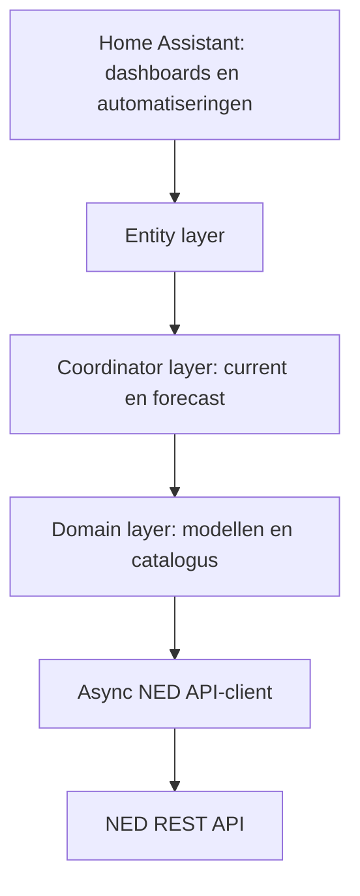
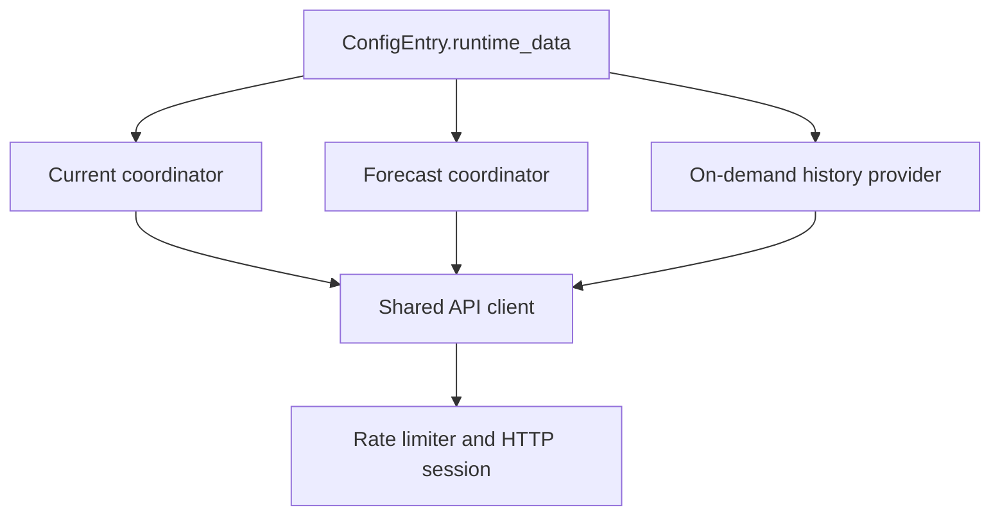

# Integratieplan — Nationaal Energie Dashboard voor Home Assistant

| Eigenschap | Waarde |
| --- | --- |
| Ontwerpversie | 1.0.0 |
| Documentdatum | 24 november 2026 |
| Status | Voorgesteld technisch ontwerp; niet geïmplementeerd |
| Repository | [HiDiHo01/ha-Nationaal-Energie-Dashboard](https://github.com/HiDiHo01/ha-Nationaal-Energie-Dashboard) |
| Doelarchitectuur | Home Assistant Custom Integration |
| Kwaliteitsdoel | Platinum |
| Python | Volgt nieuwste stable Core; momenteel 3.14 (minimum 3.14.2, ontwikkelpin 3.14.10) |
| Minimale Home Assistant Core-versie | 2026.11.3 (stable, 24 november 2026) |
| Distributie | Home Assistant Marketplace (algemene catalogus) |

> Dit document legt het integratieplan vast. Ontwerpkeuzes zijn voorstellen, geen gerealiseerde functionaliteit. API-waarden zijn werkhypothesen totdat de actuele OpenAPI-specificatie, datacatalogus en geauthenticeerde contracttests deze bevestigen. De toepasselijke AGENTS.md en AI_POLICY.md zijn leidend zodra deze bestaan.

## 1. Projectdoelstelling

Ontwikkel een robuuste, schaalbare, volledig asynchrone Home Assistant-integratie voor historische, actuele en voorspelde Nederlandse energiedata, bruikbaar in sensoren, dashboards en automatiseringen. Minimaliseer belasting van de API, de event loop en de Recorder-database.

### 1.1 Technische uitgangspunten

| Onderdeel | Ontwerpkeuze |
| --- | --- |
| Domain | `nationaal_energie_dashboard` |
| Integration type | `service` |
| IoT class | `cloud_polling` |
| Python | Volgt de vastgelegde Core-baseline |
| HTTP-client | aiohttp |
| Authenticatie | API-key |
| Configuratie | Config Flow |
| Aanvullende instellingen | Options Flow |
| Gegevenscoördinatie | DataUpdateCoordinator |
| Datamodellen | Typed dataclasses |
| Tijdverwerking | Timezone-aware UTC |
| Lokale tijdzone NED | Europe/Amsterdam |
| Vertalingen | Nederlands en Engels |
| Testframework | pytest |
| Linting | Ruff en Pylint |
| Typecontrole | mypy strict |
| CI/CD | GitHub Actions |
| Distributie | Home Assistant Marketplace (algemene catalogus) |
| Kwaliteitsnorm | Home Assistant Platinum |

Platinum is vanaf het begin een ontwerpcriterium: asynchrone dependency, sessie-injectie, strikte typing en alle toepasselijke lagere kwaliteitscriteria. Er wordt geen officiële certificering geclaimd.

### 1.2 Home Assistant-versiebeleid

De minimale ondersteunde Home Assistant Core-versie is bij iedere nieuwe integratierelease de dan nieuwste stabiele Core-release, inclusief patchnummer. Controleer deze via https://version.home-assistant.io/stable.json en de officiële release-informatie. Gebruik een expliciete versie per release in hacs.json (homeassistant), documentatie en de reproduceerbare testomgeving; verhoog de grens pas voor een nieuwe integratierelease, niet met terugwerkende kracht. Oudere Core-versies, beta's en developmentversies hoeven niet ondersteund te worden. Valideer vóór publicatie installatie en tests tegen de vastgelegde baseline.

De huidige baseline is 2026.11.3, uitgebracht op 23 november 2026, bevestigd via de [stable-versiefeed](https://version.home-assistant.io/stable.json) en [release-informatie](https://www.home-assistant.io/blog/2026/11/04/release-202611/). Runtime- en dependencycompatibiliteit moeten in de ontwikkelomgeving worden gevalideerd.

### 1.3 Python-versiebeleid

De Python-doelversie volgt de major.minor-versie die de nieuwste stabiele Home Assistant Core-release gebruikt. Controleer bij het vaststellen van de Core-baseline de officiële release-tag: pyproject.toml (requires-python en toolversies) en .python-version (exacte ontwikkelversie). Neem de officiële minimale Python-versie over en pin de ontwikkelomgeving op de bijbehorende exacte Python-versie. Gebruik dezelfde major.minor-versie voor Ruff, Pylint, mypy en CI. Herbeoordeel deze waarden bij elke nieuwe integratierelease; pas oudere releases niet met terugwerkende kracht aan. Kies nooit zelfstandig een nieuwere Python-generatie dan de vastgelegde Core-baseline.

Baseline 24 november 2026: Home Assistant Core 2026.11.3, Python 3.14, upstream requires-python >=3.14.2 en ontwikkelversie 3.14.10. Bronnen: [Core pyproject.toml](https://github.com/home-assistant/core/blob/2026.11.3/pyproject.toml) en [Core .python-version](https://github.com/home-assistant/core/blob/2026.11.3/.python-version).

## 2. Functionele scope

### 2.1 Energiedatasets

Actuele gegevens dienen sensoren en automatiseringen; historische tijdreeksen dienen analyse; voorspellingen dienen planning.

| Dataset | Voorgesteld NED Type ID | Prioriteit |
| --- | ---: | --- |
| Windenergie op land | 1 | P0 |
| Zonne-energie | 2 | P0 |
| Windenergie op zee | 51 | P0 |
| Elektriciteitsmix | 27 | P0 |
| CO₂-emissiefactor elektriciteit | 27 | P0 |
| Elektriciteitsverbruik | 59 | P0 |
| Hernieuwbare energie totaal | 0 | P1 |
| Gascentrales | 18 | P1 |
| Steenkool | 19 | P1 |
| Kernenergie | 20 | P1 |
| Gasverbruik huishoudens | 55 | P1 |
| Totaal gasverbruik | 56 | P1 |
| Gasverbruik industrie | 53 | P2 |
| Gasverbruik elektriciteitscentrales | 54 | P2 |
| Elektriciteitsimport | 27 | P2 |
| Elektriciteitsexport | 27 | P2 |
| Gasopslag en gasstromen | 28 | P2 |

P0 is essentieel voor de eerste release, P1 is uitbreiding, P2 is geavanceerde ondersteuning. Type ID alleen is onvoldoende: ook activiteit, geografisch punt, granulariteit, tijdzone en classificatie bepalen de dataset. De officiële datacatalogus is leidend; bevestig iedere combinatie afzonderlijk.

### 2.2 Gebruiksdoeleinden

- Elektrische voertuigen, warmtepompen, boilers en andere energie-intensieve apparaten plannen op basis van beschikbare voorspellingen.
- Nationale elektriciteitsproductie, consumptie en CO₂-intensiteit visualiseren.
- Wind- en zonnevoorspellingen weergeven.
- Regionale productie vergelijken en historische ontwikkelingen analyser.

De integratie levert gegevens en bestuurt geen apparaten. Nationale opwek is geen voorspelling van individuele zonnepanelen of een meting van huishoudelijk verbruik. Een lage CO₂-intensiteit impliceert geen lage stroomprijs.

## 3. API-architectuur

### 3.1 API-verbinding

| Eigenschap | Te verifiëren contract |
| --- | --- |
| Base URL | https://api.ned.nl/v1 |
| Transport | HTTPS |
| Protocol | REST |
| Dataformaat | JSON-LD |
| Authenticatieheader | X-AUTH-TOKEN |
| Accept-header | application/ld+json |
| API-versie | v1 |
| Gedocumenteerde rate limit | 200 requests per 5 minuten |

Bronnen: [API-handleiding](https://ned.nl/nl/handleiding-api), [Swagger](https://api.ned.nl/v1). Bevestig tevens de scope van de rate limit (API-key, account of andere beperking).

### 3.2 Primair endpoint

```http
GET https://api.ned.nl/v1/utilizations
```

### 3.3 Requestparameters

| Parameter | Functie |
| --- | --- |
| point | Geografische locatie |
| type | Energiedrager |
| granularity | Tijdsinterval |
| granularitytimezone | Tijdzone van aggregatie |
| classification | Actueel of voorspelling |
| activity | Activiteitstype |
| validfrom[after] | Begin zoekinterval; inclusiviteit verifiëren |
| validfrom[strictly_before] | Exclusief einde zoekinterval |

Centraliseer samenstelling en validatie van parameters in de client; entities bouwen geen requests.

### 3.4 Classificaties

| ID | Enum | Betekenis |
| ---: | --- | --- |
| 1 | FORECAST | Voorspelling |
| 2 | CURRENT | Actuele en historische gegevens |

Historie wordt geselecteerd met een historisch datuminterval, niet als aparte classificatie.

### 3.5 Activiteiten

| ID | Enum |
| ---: | --- |
| 1 | PROVIDING |
| 2 | CONSUMING |
| 3 | IMPORT |
| 4 | EXPORT |
| 5 | STORAGE_IN |
| 6 | STORAGE_OUT |
| 7 | STORAGE |

### 3.6 Granulariteit

| ID | Interval | Implementatie |
| ---: | --- | --- |
| 3 | 10 minuten | Ondersteunen waar beschikbaar |
| 4 | 15 minuten | Standaard |
| 5 | 1 uur | Ondersteunen |
| 6 | 1 dag | Historie en aggregaties |
| 7 | 1 maand | Historie |
| 8 | 1 jaar | Historie |

Bied alleen geldige datasetcombinaties aan. Gebruik kwartierdata als MVP-uitgangspunt; tienminutendata is niet voor alle elektriciteitsdatasets beschikbaar.

### 3.7 Geografische ondersteuning

Nederland (point 0) is standaard. Provincies (voorgestelde point-ID's 1–12), windparken, grensstromen en gaslocaties worden uitsluitend aangeboden voor ondersteunde datasets. Valideer alle ID's en combinaties aan de hand van de catalogus.

## 4. Softwarearchitectuur



### 4.1 Architectuurprincipes

Single Responsibility, Separation of Concerns, Dependency Injection, composition over inheritance, immutable datamodellen waar mogelijk. Geen netwerkverzoeken in entity-properties, geen circulaire imports, geen blokkerende I/O en één centrale datasetcatalogus.

De API-client is een zelfstandig Python-package zonder Home Assistant-afhankelijkheid. Ontwikkel, bouw en test het onafhankelijk. Valideer in fase 0 een reproduceerbare Marketplace-compatibele runtime-installatiemethode; eindgebruikers mogen geen ontwikkelaarscheckout nodig hebben. Publieke packagepublicatie vereist toestemming.

## 5. Voorgestelde repositorystructuur

```text
ha-Nationaal-Energie-Dashboard/
├── .github/
│   ├── ISSUE_TEMPLATE/
│   ├── workflows/
│   │   ├── ci.yaml
│   │   ├── baseline-watch.yaml
│   │   ├── python-next-smoke.yaml
│   │   ├── hassfest.yaml
│   │   ├── hacs.yaml
│   │   ├── api-contract.yaml
│   │   └── release.yaml
│   ├── dependabot.yml
│   └── pull_request_template.md
├── custom_components/
│   └── nationaal_energie_dashboard/
│       ├── __init__.py
│       ├── const.py
│       ├── config_flow.py
│       ├── coordinator.py
│       ├── entity.py
│       ├── sensor.py
│       ├── binary_sensor.py
│       ├── models.py
│       ├── descriptions.py
│       ├── diagnostics.py
│       ├── repairs.py
│       ├── services.py
│       ├── services.yaml
│       ├── manifest.json
│       ├── quality_scale.yaml
│       ├── icons.json
│       ├── strings.json
│       ├── brand/
│       │   └── icon.png
│       └── translations/
│           ├── en.json
│           └── nl.json
├── packages/
│   └── ned-api/
│       ├── pyproject.toml
│       └── src/
│           └── ned_api/
│               ├── __init__.py
│               ├── client.py
│               ├── const.py
│               ├── enums.py
│               ├── exceptions.py
│               ├── models.py
│               ├── catalog.py
│               ├── parser.py
│               ├── rate_limiter.py
│               └── py.typed
├── tests/
│   ├── api/
│   ├── integration/
│   ├── fixtures/
│   └── conftest.py
├── docs/
│   ├── INTEGRATION_PLAN.md
│   ├── ARCHITECTURE.md
│   ├── API_REFERENCE.md
│   ├── DATASETS.md
│   ├── INSTALLATION.md
│   ├── CONFIGURATION.md
│   ├── ENTITIES.md
│   ├── AUTOMATIONS.md
│   ├── TROUBLESHOOTING.md
│   └── DEVELOPMENT.md
├── USAGE_TERMS.md
├── AGENTS.md
├── AI_POLICY.md
├── CONTRIBUTING.md
├── SECURITY.md
├── CHANGELOG.md
├── README.md
├── hacs.json
├── pyproject.toml
├── .pre-commit-config.yaml
├── .gitignore
└── .editorconfig
```

### 5.1 Verantwoordelijkheden

| Module | Verantwoordelijkheid |
| --- | --- |
| client.py | Asynchrone HTTP-communicatie |
| catalog.py | Geldige datasetcombinaties |
| enums.py | API-parameterwaarden |
| parser.py | Responsevalidatie en normalisatie |
| rate_limiter.py | Requestbudget en throttling |
| coordinator.py | Updates, caching en beschikbaarheid |
| entity.py | Gedeeld entity-gedrag |
| sensor.py | Sensorimplementaties |
| descriptions.py | Declaratieve entity-definities |
| config_flow.py | Configuratie en authenticatie |
| diagnostics.py | Geredigeerde diagnostiek |
| repairs.py | Gebruikersgerichte herstelacties |
| services.py | Historie en voorspellingen |
| quality_scale.yaml | Traceerbaarheid kwaliteitscriteria |

Voeg modules pas toe bij een concrete verantwoordelijkheid; vermijd lege placeholders. Valideer de vertaal- en manifestbestanden voor de gekozen Home Assistant- en HACS-versies.

## 6. Datamodellen

| Model | Functie |
| --- | --- |
| DatasetKey | Unieke datasetidentificatie |
| DatasetDefinition | Eigenschappen en beperkingen |
| EnergyRecord | Genormaliseerd API-record |
| EnergySeries | Geordende tijdreeks |
| DatasetSnapshot | Datastatus per dataset |
| CoordinatorData | Coordinator-snapshot |
| NedRuntimeData | Runtime-objecten van de config entry |

### 6.1 Datasetidentificatie

```python
from dataclasses import dataclass


@dataclass(frozen=True, slots=True, kw_only=True)
class DatasetKey:
    """Identify a unique NED energy dataset."""

    type_id: int
    point_id: int
    activity_id: int
    granularity_id: int
    classification_id: int
    granularity_timezone_id: int
```

### 6.2 Genormaliseerd energierecord

```python
from dataclasses import dataclass
from datetime import datetime


@dataclass(frozen=True, slots=True, kw_only=True)
class EnergyRecord:
    """Represent a normalized NED energy interval."""

    dataset: DatasetKey
    valid_from: datetime
    valid_to: datetime
    last_update: datetime | None = None
    capacity_kw: float | None = None
    volume_kwh: float | None = None
    emission_kg: float | None = None
    emission_factor_kg_kwh: float | None = None
    utilization_ratio: float | None = None
```

De parser valideert bronwaarden en catalogusreferenties; dataclasses bevatten genormaliseerde gegevens. De veldnamen zijn interne ontwerpkeuzes, geen letterlijk API-contract.

### 6.3 Datavalidatie

| Situatie | Verwerking |
| --- | --- |
| null | Ontbrekende waarde behouden |
| Numerieke nul | Geldige waarde |
| NaN of oneindig | Afwijzen |
| Ontbrekend optioneel veld | None |
| Ongeldige tijdstempel | Record afwijzen |
| Tijdstempel zonder tijdzone | Afwijzen tenzij contract eenduidig is |
| Ongeldig geldigheidsinterval | Record afwijzen |
| Dubbele records | Dedupliceren |
| Ongeordende records | Chronologisch sorteren |
| Historische revisie | Nieuwste geldige versie verwerken |
| Onbekend extra JSON-veld | Negeren |
| Ontbrekende verplichte structuur | Gecontroleerde API-fout |

Negatieve waarden zijn niet generiek ongeldig. Valideer ze per dataset en metriek.

## 7. Asynchrone NED API-client

```python
from aiohttp import ClientSession


class NedApiClient:
    """Provide asynchronous access to the NED API."""

    def __init__(self, api_key: str, session: ClientSession) -> None:
        """Initialize the client with a shared HTTP session."""
        if not api_key.strip():
            raise ValueError("A non-empty NED API key is required.")

        self._api_key = api_key.strip()
        self._session = session
```

Home Assistant injecteert de sessie via `homeassistant.helpers.aiohttp_client.async_get_clientsession`. De API-client sluit een geleende sessie niet zelf.

### 7.1 Publieke clientinterface

| Methode | Functie |
| --- | --- |
| async_validate_connection() | Bereikbaarheid en authenticatie |
| async_get_utilizations() | Algemene tijdreeks |
| async_get_current() | Actuele gegevens |
| async_get_forecast() | Voorspellingen |
| async_get_history() | Historische gegevens |
| async_get_supported_datasets() | Datasetdefinities |

### 7.2 Requestpipeline

1. Valideer invoer en datasetcombinatie.
2. Controleer het beschikbare requestbudget.
3. Voer HTTP-request met timeout uit.
4. Controleer HTTP-status en responseformaat.
5. Verwerk eventuele paginering veilig en begrensd.
6. Normaliseer en valideer records.
7. Dedupliceer en sorteer.
8. Retourneer getypeerde resultaten.

Interne methoden beginnen met een underscore, bijvoorbeeld _async_request(), _async_fetch_pages() en _parse_record(). Bevestig het pagineringscontract en sta alleen veilige, toegestane NED-next-links toe. Stuur credentials nooit naar externe hosts.

## 8. Pollingstrategie en rate limiting

### 8.1 Voorgestelde intervallen

| Datatype | Update-interval |
| --- | --- |
| Actuele gegevens | 5 minuten |
| Voorspellingen | 60 minuten |
| Dagaggregaties | 60 minuten, indien gebruikt |
| Datasetcatalogus | 24 uur, indien via API opgehaald |
| Historie | Op aanvraag |
| Diagnostics | Geen zelfstandig request |

Stel deze waarden bij op basis van de werkelijke publicatiefrequentie en contracttests.

### 8.2 Belastingsmodel

Zonder batching, retries of handmatige requests, met C actuele datasets, F forecastdatasets, intervallen Ic en If in minuten en P pagina's per opvraging:

- Requests per uur: P × (C × 60/Ic + F × 60/If).
- Conservatieve periodieke piek per vijf minuten: P × (C × ceil(5/Ic) + F × ceil(5/If)).
- Voorbeeld: vijf actuele datasets per vijf minuten, vijf forecastdatasets per uur en één pagina geven 65 requests per uur en maximaal circa tien periodieke requests per vijf minuten.

Dit is een planningsmodel, geen garantie. Werkelijke pieken hangen ook af van retries, initiële setup, handmatige actions, paginering en andere clients die hetzelfde budget gebruiken.

### 8.3 Optimalisatie

- Gedeelde requests voor meerdere metrics uit één dataset.
- Batching uitsluitend na contractvalidatie.
- Concurrency standaard drie gelijktijdige requests.
- Requestdeduplicatie en caching.
- Begrensde exponential backoff met jitter en respect voor Retry-After.
- Intern budget maximaal 120 requests per vijf minuten tegenover de te bevestigen API-limiet van 200.
- Geen periodieke polling voor uitgeschakelde, ongebruikte datasets.
- Eén centrale limiter voor alle requests, inclusief retries, setup en paginering.

## 9. DataUpdateCoordinator



### 9.1 NedCurrentCoordinator

Actuele en recent afgesloten intervallen, actuele sensoren, staleness en ontbrekende gegevens.

### 9.2 NedForecastCoordinator

Forecasttijdreeksen, geselecteerde forecast-sensoren en samenvattingen.

### 9.3 Historische dataprovider

Op aanvraag; geen onbeperkte lokale historische database of aparte periodieke coordinator.

### 9.4 Coordinatoroptimalisaties

Gebruik CoordinatorEntity, always_update=False wanneer snapshotvergelijking betrouwbaar is, entity-contexten, async_config_entry_first_refresh() voor essentiële gegevens en getypeerde snapshots. Isoleer gedeeltelijke datasetuitval. Statuswijzigingen moeten een entity-update veroorzaken, ook als de numerieke waarde niet verandert.

## 10. Config Flow en Options Flow

### 10.1 Eerste configuratie

Voorgestelde invoer: API-key (gemaskeerd), Nederland als standaardlocatie, kwartiergranulariteit en P0-datasets (zon, wind op land, wind op zee, elektriciteitsproductie, verbruik en CO₂-emissiefactor). Valideer de key met een beperkt bekend geldig request; een lege dataset betekent niet automatisch ongeldige authenticatie.

### 10.2 Config entry

Eén config entry voor de dienst, met meerdere regio's en datasets. Voorkom duplicaten.

| Instelling | Opslag |
| --- | --- |
| API-key | ConfigEntry.data |
| Datasets, regio's, granulariteit | ConfigEntry.options |
| Polling en forecastinstellingen | ConfigEntry.options |
| Client en coordinators | ConfigEntry.runtime_data |
| Tijdreekscache | Runtimegeheugen |

### 10.3 Options Flow

Aanpassen van datasets, regio's, forecastfunctionaliteit en begrensde pollingintervallen.

### 10.4 Reauthentication Flow

Start native herauthenticatie bij bevestigde authenticatiefout. Valideer de nieuwe key, update en reload de bestaande entry zonder duplicaten of gewijzigde unique IDs.

### 10.5 Reconfiguration Flow

Ondersteun wijziging van primaire configuratie; behoud entity registry-instellingen.

## 11. Sensorarchitectuur

Gebruik declaratieve SensorEntityDescription-definities met een gedeelde sensorklasse.

### 11.1 Eerste entities

Zonne-energie, windenergie op land, windenergie op zee, elektriciteitsproductie, elektriciteitsconsumptie en CO₂-emissiefactor. Gebruik bronwaarden en correcte eenheden; voorbeelden zijn geen actuele data.

### 11.2 Sensorclassificaties

| Sensortype | Eenheid | Device class | State class |
| --- | --- | --- | --- |
| Actueel vermogen | kW | POWER | MEASUREMENT |
| Energie per interval | kWh | ENERGY | Geen in MVP |
| Energie per dag | kWh | ENERGY | Geen in MVP |
| CO₂-uitstoot per interval | kg | WEIGHT | Geen |
| CO₂-intensiteit | g/kWh | Geen | MEASUREMENT |
| Benuttingsgraad | % | Geen | MEASUREMENT |
| Voorspeld vermogen | kW | POWER | Geen |
| Voorspelde energie | kWh | ENERGY | Geen |
| Voorspelde CO₂-intensiteit | g/kWh | Geen | Geen |
| Laatste bronupdate | Timestamp | TIMESTAMP | Geen |
| Voorspeld optimaal tijdstip | Timestamp | TIMESTAMP | Geen |

Valideer deze classificaties tegen de actuele Home Assistant-sensorregels. Intervalvolumes zijn niet automatisch TOTAL_INCREASING. Forecasts zijn geen actuele metingen voor long-term statistics.

### 11.3 Entity naming

Gebruik has_entity_name=True en vertaalbare descriptions. Illustratieve entity-ID's (Home Assistant genereert deze; gebruiker kan ze wijzigen):

```text
sensor.ned_nederland_solar_power
sensor.ned_nederland_wind_onshore_power
sensor.ned_nederland_wind_offshore_power
sensor.ned_nederland_electricity_production
sensor.ned_nederland_electricity_consumption
sensor.ned_nederland_co2_intensity
sensor.ned_nederland_co2_intensity_forecast
sensor.ned_nederland_solar_forecast_today
sensor.ned_nederland_solar_forecast_tomorrow
```

### 11.4 Unique ID

```text
{entry_id}_{point_id}_{type_id}_{activity_id}_{granularity_id}_{timezone_id}_{classification_id}_{metric}
```

Behoud stabiele IDs bij restart, reload en keywijziging. Leg migraties vast wanneer de identificatiestrategie verandert.

### 11.5 Device Registry

Groepeer logische serviceapparaten per geografisch gebied: Nederland, Noord-Holland en overige geselecteerde regio's. Het zijn logische clouddienstgroeperingen, geen fysieke apparaten.

## 12. Eenheden en energieberekeningen

### 12.1 Vermogen en energie

Energie (kWh) = gemiddeld vermogen (kW) × intervalduur (uur). Bijvoorbeeld 1.000 kW gedurende 15 minuten = 250 kWh. Gebruik geldig API-volume als primaire bron. Bereken alleen een fallback indien de veldsemantiek dit rechtvaardigt.

### 12.2 CO₂-emissiefactor

g/kWh = kg/kWh × 1.000. Voorbeeld: 0,184 kg/kWh = 184 g/kWh. Ontbrekende intensiteit is geen nul; controleer de betekenis van de productie- of consumptiemix.

### 12.3 Gewogen gemiddelde

I_gewogen = som(E_i × I_i) / som(E_i), waarbij E_i het bijbehorende energievolume is. Vereis geldige dekking en een niet-nul noemer. Een gewoon rekenkundig gemiddelde is niet altijd representatief.

### 12.4 Benuttingsgraad

Converteer een eenheidsloze ratio naar procenten na contractvalidatie. Benuttingsgraad is niet hetzelfde als aandeel van een energiebron in de totale productie.

### 12.5 Energy Dashboard

Registreer nationale productie niet als huishoudelijk verbruik of eigen zonnepanelenproductie. Beloof geen directe CO₂-integratie met het Energy Dashboard voordat semantische en technische compatibiliteit is vastgesteld.

## 13. Forecast Engine

De catalogus noemt voor bepaalde datasets een horizon tot zeven dagen. Gebruik de daadwerkelijk ontvangen tijdreeks en dekking; verifieer de horizon per dataset.

### 13.1 Forecastfuncties

| Functie | Resultaat |
| --- | --- |
| Huidig interval | Verwachte waarde |
| Volgend uur | Verwachte gemiddelde waarde |
| Vandaag/morgen | Verwacht dagvolume |
| Maximum/minimum komende 24 uur | Hoogste/laagste waarde |
| Tijdstip maximum/minimum | Timestamp |
| Laagste CO₂-periode | Gunstig beschikbaar tijdvenster |
| Duurzame productieperiode | Hoge verwachte opwek |
| Forecastdekking | Beschikbare intervallen |

### 13.2 Visualisatie

Toon een tijdreeks van CO₂-intensiteit in g/kWh met het geselecteerde gunstige venster. Voorbeeld met fictieve waarden: minimum 71 g/kWh en een venster rond het middaguur. Gebruik geen illustratieve waarden als echte sensorwaarden.

### 13.3 Optimalisatiealgoritme

Selecteer het aaneengesloten toekomstige tijdvenster met de laagste verwachte intensiteit voor de gevraagde looptijd. Bij gelijkwaardige uitkomsten kiest het algoritme het vroegste venster. Houd rekening met ontbrekende intervallen, intervalduur, verstreken forecasts en DST. Voor variabel apparaatvermogen wordt gewogen op verwacht energieverbruik; bij constant vermogen volstaat een tijdgewogen gemiddelde.

Illustratieve reeks uurwaarden in g/kWh:

```text
244, 235, 221, 205, 186, 175, 165, 148, 124, 98, 71, 74,
81, 90, 112, 136, 172, 198, 231, 257, 248, 236, 227, 219
```

De gunstigste drie opeenvolgende voorbeelduren zijn 10:00–13:00, gemiddeld 75,3 g/kWh. Dit is uitsluitend een fictief rekenvoorbeeld, geen actueel advies. Prijsoptimalisatie valt buiten scope.

## 14. Home Assistant Actions

Gebruik response data voor omvangrijke tijdreeksen in plaats van honderden attributen in Recorder.

| Action | Prioriteit | Functie |
| --- | --- | --- |
| get_forecast | P0 | Voorspelde tijdreeks |
| get_history | P1 | Historische tijdreeks |
| get_optimal_period | P1 | Optimaal tijdvenster |
| get_datasets | P1 | Ondersteunde datasets |

Registreer actions in async_setup() met SupportsResponse.ONLY, gevalideerde invoer en expliciete geldige config_entry_id wanneer de action entrygebonden is. Begrens datumbereiken, responsegrootte en requestbudget.

### 14.1 Voorbeeld

```yaml
action: nationaal_energie_dashboard.get_forecast
data:
  config_entry_id: "<config_entry_id>"
  dataset: electricity_mix
  metric: emission_factor
  point_id: 0
  hours: 24
response_variable: ned_forecast
```

### 14.2 Voorgesteld responsecontract

```json
{
  "dataset": "electricity_mix",
  "metric": "emission_factor",
  "classification": "forecast",
  "unit": "g/kWh",
  "point_id": 0,
  "complete": true,
  "records": [
    {
      "valid_from": "2026-11-25T08:00:00+00:00",
      "valid_to": "2026-11-25T08:15:00+00:00",
      "value": 158.2
    },
    {
      "valid_from": "2026-11-25T08:15:00+00:00",
      "valid_to": "2026-11-25T08:30:00+00:00",
      "value": 152.4
    }
  ]
}
```

Fictief, verkort voorbeeld van het interne contract, niet een letterlijke NED-response. In productie moet complete de werkelijk aangevraagde horizon beschrijven.

## 15. Tijdzonebeheer en historie

Gebruik timezone-aware datetimes:

```python
from datetime import datetime, timezone

now = datetime.now(timezone.utc)
```

Onderscheid UTC-tijdstempels, Home Assistant-gebruikerstijdzone en Nederlandse kalenderaggregaties. De handleiding noemt granularitytimezone=0 voor UTC en 1 voor Nederlandse tijd; dag-, maand- en jaaraggregaties vereisen volgens de handleiding 1. Het eerdere plan constateerde inconsistentie met een documentatievoorbeeld. Bevestig dit met contracttests.

| Nederlandse kalenderdag | Uren | Kwartierintervallen |
| --- | ---: | ---: |
| Normaal | 24 | 96 |
| Ingang zomertijd | 23 | 92 |
| Ingang wintertijd | 25 | 100 |

Gebruik geen vaste 96 records per dag. Dedupliceer historische revisies op dataset en geldigheidsinterval. Gebruik lastupdate voor revisieselectie, maar beschouw een wijziging van lastupdate niet automatisch als gewijzigde meetwaarde. Vervang oudere records; tel revisies niet op.

## 16. Foutafhandeling en beschikbaarheid

### 16.1 Exception hierarchy

```text
NedApiError
├── NedAuthenticationError
├── NedPermissionError
├── NedConnectionError
├── NedTimeoutError
├── NedRateLimitError
├── NedResponseError
├── NedValidationError
└── NedUnsupportedDatasetError
```

### 16.2 HTTP-foutafhandeling

| Situatie | Gedrag |
| --- | --- |
| 200 | Response valideren |
| 400 | Requestfout, geen retry |
| 401 | Authenticatieprobleem |
| 403 | Autorisatieprobleem onderzoeken |
| 404 | Endpoint of dataset controleren |
| 429 | Throttling en backoff |
| 500–599 | Tijdelijke storing, begrensde retry |
| Timeout/DNS | Tijdelijke verbindingsfout |
| Ongeldige JSON | Responsefout |
| Lege tijdreeks | Afzonderlijke datastatus |
| Coroutine geannuleerd | Annulering doorgeven |

Verifieer 401/403-semantiek; start geen reauth voor een onbewezen authenticatiefout.

### 16.3 Home Assistant-mapping

| Situatie | Mechanisme |
| --- | --- |
| Tijdelijke setupfout | ConfigEntryNotReady |
| Bevestigde authenticatiefout | ConfigEntryAuthFailed |
| Mislukte periodieke update | UpdateFailed |
| Ongeldige action-invoer | ServiceValidationError |
| Operationele action-fout | HomeAssistantError |
| Langdurig herstelbaar probleem | Repair issue |

### 16.4 Datastatus

Actueel → tijdelijk verouderd → unavailable bij verstreken geldigheid; automatisch herstel na succesvolle update. Respecteer native coordinatorbeschikbaarheid. Bewaar eventueel de laatste succesvolle waarde intern, maar presenteer verouderde data niet ongemerkt als actueel. Controleer leeftijd en geldigheid per dataset.

## 17. Beveiliging, privacy en logging

HTTPS en certificaatvalidatie verplicht. Geen API-key in URL, logging, diagnostiek of GitHub. Verbied onveilige redirects, begrens timeout, responsegrootte en pagina's, valideer invoer en scan dependencies. Gebruik het reguliere config-entrymechanisme; beweer niet dat secrets automatisch versleuteld op schijf zijn.

### 17.1 Logging

Gebruik lazy formatting, geen f-strings in loggingcalls:

```python
_LOGGER.debug(
    "Retrieved %s records for dataset %s",
    record_count,
    dataset_key,
)
```

DEBUG: requestduur, dataset, recordaantallen. INFO: operationele statuswijzigingen. WARNING: herstelbare afwijkingen. ERROR: ernstige operationele fouten. Voorkom herhaalde logspam.

### 17.2 Diagnostics

Versie, geselecteerde datasets, update-intervallen, laatste succesvolle update, recordaantallen, datadekking en rate-limiterstatus. Redigeer API-keys, headers, accountgegevens en onbewerkte exceptions die credentials kunnen bevatten.

## 18. Home Assistant Platinum Quality Scale

De officiële schaal is cumulatief. Leg alle toepasselijke criteria vast volgens de actuele officiële documentatie.

| Niveau | Belangrijkste oplevercriteria |
| --- | --- |
| Bronze | Config flow, authenticatievalidatie, unieke entries/entities, runtime data, polling, basisdocumentatie |
| Silver | Reload/unload, reauth, beschikbaarheid, concurrency, testdekking |
| Gold | Diagnostics, vertalingen, relevante repairs, reconfiguratie, registry, gebruikersdocumentatie |
| Platinum | Asynchrone dependency, sessie-injectie, strikte typing |

### 18.1 quality_scale.yaml

Ieder toepasselijk criterium heeft een onderbouwde status done, todo of exempt; controleer de actuele bestandsstructuur en syntaxis. Motiveer uitzonderingen, bijvoorbeeld discovery van fysieke apparaten voor deze clouddienst. Deze tabel is een samenvatting, geen volledige officiële criterialijst. Platinum is een intern aantoonbaar kwaliteitsdoel, geen automatisch toegekende certificering.

## 19. Teststrategie

Testpiramide: brede unit tests voor API, modellen, parser en berekeningen; Home Assistant-integratietests voor lifecycle en entities; beperkte opt-in live API-contracttests.

### 19.1 Interne streefdekking

| Onderdeel | Streefdekking |
| --- | ---: |
| Config Flow | 100% |
| API-client, parser, modellen | ≥95% |
| Forecastberekeningen | 100% |
| Coordinator, sensors, services | ≥95% |
| Diagnostics | 100% |
| Totale branch coverage | ≥95% |

Dit zijn projectdoelen, niet allemaal officiële Platinum-drempels.

### 19.2 Testacceptatiechecklist

API-client:

- [ ] Geldige API-response.
- [ ] Ongeldige authenticatie.
- [ ] Timeout en verbindingsverlies.
- [ ] HTTP 429 en Retry-After.
- [ ] Paginering en onveilige next-links.
- [ ] Malformed JSON en ontbrekende velden.
- [ ] Requestbudget bij concurrency.
- [ ] Annulering van requests.

Home Assistant:

- [ ] Succesvolle config flow.
- [ ] Dubbele config entry voorkomen.
- [ ] Setup bij onbereikbare API.
- [ ] Reauth en reconfigure.
- [ ] Reload en unload.
- [ ] Entity unique IDs behouden.
- [ ] Gedeeltelijke datasetuitval.
- [ ] Automatisch herstel.

Datakwaliteit:

- [ ] Ontbrekende waarden versus nul.
- [ ] Duplicaten en historische revisies.
- [ ] Ongesorteerde tijdreeksen.
- [ ] Eenheidsconversies.
- [ ] Zomer- en wintertijd.
- [ ] Onvolledige forecast.
- [ ] Gewogen CO₂-gemiddelde.
- [ ] Optimale aaneengesloten tijdvensters.

Security en kwaliteit:

- [ ] API-keyredactie.
- [ ] Geen blokkerende I/O.
- [ ] Strict typing.
- [ ] HACS-validatie.
- [ ] Hassfest-validatie.
- [ ] Dependency scanning.
- [ ] Geen achterblijvende async-taken.

Reguliere CI gebruikt reproduceerbare fixtures en gemockte responses zonder persoonlijke API-key. Live contracttests zijn gescheiden, opt-in, begrensd en gebruiken veilig geïnjecteerde credentials.

### 19.3 Forward Compatibility Testing

- De Home Assistant/Python-baseline blijft leidend voor productiecode, linting, strict typing, volledige integratietests en de verplichte coveragepoorten.
- Onderhoud de afzonderlijke workflow python-next-smoke.yaml voor de eerstvolgende Python-major.minor-generatie (momenteel 3.15, productie 3.14). Deze experimentele job is niet releaseblokkerend (continue-on-error: true); failures blijven zichtbaar in de jobdetails. Bij een Core/Python-upgrade schuift de experimentele versie mee. Introduceer geen next-only syntax in productiecode.
- Draai op push, pull request en workflow_dispatch met alleen contents: read, zonder API-secrets of installatie van Home Assistant/het root-dev-dependencygroup.
- Controleer de volgende-versierelatie met .python-version, compileer aanwezige Python-bronnen, installeer de zelfstandige ned_api-library vanuit packages/ned-api, voer pip check en een import uit en draai offline tests/api zonder de root-coveragepoort.
- Voeg in fase 1 een zelfstandige test-extra toe aan packages/ned-api/pyproject.toml (pytest, pytest-asyncio en alle vereiste API-testdependencies, geen Home Assistant). API-tests en fixtures zijn onafhankelijk van Home Assistant; plaats noodzakelijke conftest-fixtures onder tests/api. Sluit live_api-tests uit.
- Zolang broncode of tests ontbreken, rapporteert de workflow expliciet welke controles niet zijn uitgevoerd. Een groene experimentele job is geen bewijs van volledige runtimecompatibiliteit of Platinum.

## 20. CI/CD en kwaliteitscontroles

### 20.1 GitHub Actions

Push/PR → Python-omgeving en dependencies → Ruff → Pylint en mypy → unit- en integratietests → coverage en security scanning → Hassfest en HACS → build/releasevalidatie → geautoriseerde release en Marketplace-catalogusaanmelding na geslaagde controles.

De actieve workflows zijn beschreven in [.github/workflows/README.md](../.github/workflows/README.md) en AGENTS.md paragraaf 13.3. De productie-CI bevat ook afzonderlijke branchcoverage en modulespecifieke coveragecontroles; onderhoud deze met de daadwerkelijke module-indeling. De dagelijkse baseline-watch is een waarschuwingssignaal, geen automatische versie-upgrade. De Python-next-run is geslaagd, maar er was nog geen API-library om te testen. Baseline-uitvoering, volledige dependencyresolutie en officiële Hassfest/Marketplace-validaties blijven open.

### 20.2 Beoogde lokale commando's

```bash
ruff format --check .
ruff check .
pylint custom_components/nationaal_energie_dashboard
pylint packages/ned-api/src/ned_api
mypy
pytest --cov --cov-branch --cov-report=term-missing
pip-audit
```

De root-pyproject.toml bevat de ontwikkelgroep en centrale toolconfiguratie. De officiële pytest-homeassistant-plugin is gekoppeld aan de exacte Core-baseline. Branchmeting is ingeschakeld en de gecombineerde coverage-drempel is 95%; afzonderlijke branchcoverage en de per-module-doelen moeten aanvullend in CI worden afgedwongen. Volledige dependencyresolutie, lockfile en uitvoering op de vastgelegde Python-versie volgen bij de ontwikkelomgeving. De codecontroles zijn nog niet uitvoerbaar zolang de broncode en tests ontbreken.

### 20.3 Branchbeleid (voorstel)

| Branch | Functie |
| --- | --- |
| main | Stabiele ontwikkelbasis |
| feature/* | Nieuwe functionaliteit |
| fix/* | Bugfixes |
| docs/* | Documentatie |

Richt pull requests, verplichte statuschecks en branchbescherming in vóór reguliere ontwikkeling.

## 21. Implementatiefasen

Indicatieve inspanning, geen gegarandeerde kalenderdoorlooptijd.

| Fase | Inspanning | Resultaat |
| --- | ---: | --- |
| 0. Fundament | 3 werkdagen | Repository, beleid en tooling |
| 1. API-client | 5 werkdagen | Contract, modellen, async client |
| 2. Core-integratie | 4 werkdagen | Config Flow en coordinators |
| 3. Sensors | 4 werkdagen | Entities, registry en eenheden |
| 4. Forecast | 5 werkdagen | Voorspellingen en actions |
| 5. Robustness | 4 werkdagen | Diagnostics, repairs en fouten |
| 6. Quality & CI | 5 werkdagen | Tests, typing en validatie |
| 7. Release en Marketplace | 2 werkdagen (interne voorbereiding; review niet inbegrepen) | Release, catalogusaanmelding en documentatie |
| Totaal | 32 werkdagen | Indicatieve inspanning |

### 21.1 Fase 0 — Repository Foundation

- [x] AGENTS.md opstellen.
- [x] AI_POLICY.md opstellen.
- [x] Auteursrechtbeleid vastleggen: beperkte Home Assistant-gebruikstoestemming, overige rechten voorbehouden.
- [ ] Actuele Marketplace-toelatingsvoorwaarden, waaronder eventuele licentievereisten, definitief bevestigen.
- [ ] Reproduceerbare Marketplace-compatibele runtime-distributiestrategie valideren.
- [x] Repositorystructuur aanmaken (basismappen, metadata en ondersteunende documentatie; modules volgen per fase).
- [x] pyproject.toml configureren en statisch valideren.
- [ ] Dependencyresolutie, lockfile en toolconfiguratie op de exacte Python/Core-baseline valideren.
- [ ] Ontwikkelomgeving en pre-commit inrichten.
- [x] Basis-CI, Hassfest, Marketplace-validatie, baseline-watch en Dependabot configureren en statisch valideren.
- [ ] Baseline-CI op GitHub Actions uitvoeren; lockfile-kandidaat controleren, committen en volledige installatie verifiëren.
- [x] Afzonderlijke niet-blokkerende Python-next-smokeworkflow configureren en statisch valideren.
- [x] Python-next-workflow op GitHub Actions uitvoeren en resultaat verifiëren (run 45447217991; Python-setup en baselinecontrole, nog geen librarycode/tests).
- [ ] OpenAPI-contract valideren.
- [x] Minimale Home Assistant-versie vaststellen: nieuwste stable, initiële baseline 2026.11.3.
- [x] Python-baseline uit de bijbehorende Core-release vaststellen: 3.14, minimum 3.14.2, ontwikkelpin 3.14.10.

### 21.2 Fase 1 — API-client

- [ ] Zelfstandig Python-package implementeren.
- [ ] Zelfstandige API-test-extra en fixtures inrichten; offline Python-next-smoketest uitvoeren zodra de library beschikbaar is.
- [ ] Enums en datasetcatalogus ontwikkelen.
- [ ] Datamodellen implementeren.
- [ ] Authenticatie en HTTP-client toevoegen.
- [ ] JSON-LD-parser ontwikkelen.
- [ ] Paginering en revisieverwerking implementeren.
- [ ] Rate limiter implementeren.
- [ ] API-fixtures en contracttests opstellen.

### 21.3 Fase 2 — Integration Core

- [ ] manifest.json configureren.
- [ ] Config Flow implementeren.
- [ ] Options Flow implementeren.
- [ ] Reauthentication Flow implementeren.
- [ ] Reconfiguration Flow implementeren.
- [ ] Typed runtime data toevoegen.
- [ ] Coordinators implementeren.
- [ ] Setup, reload, unload en migraties testen.

### 21.4 Fase 3 — Sensor Platform

- [ ] Basis-entity implementeren.
- [ ] Sensor descriptions definiëren.
- [ ] P0-datasets ondersteunen.
- [ ] Device Registry implementeren.
- [ ] Unique IDs valideren.
- [ ] Eenheden en beschikbaarheid valideren.
- [ ] Nederlandse en Engelse vertalingen toevoegen.

### 21.5 Fase 4 — Forecast en historie

- [ ] Forecasttijdreeksen verwerken.
- [ ] Forecastsamenvattingen ontwikkelen.
- [ ] Optimaal-tijdvensteralgoritme implementeren.
- [ ] Response actions implementeren.
- [ ] Historische opvragingen begrenzen.
- [ ] Automatiseringsvoorbeelden documenteren.

### 21.6 Fase 5 — Robustness

- [ ] Diagnostics toevoegen.
- [ ] Repair issues toevoegen waar relevant.
- [ ] Gedeeltelijke API-uitval verwerken.
- [ ] Datastaleness bewaken.
- [ ] Logging optimaliseren.
- [ ] Beveiligingscontroles uitvoeren.

### 21.7 Fase 6 — Platinum

- [ ] Alle toepasselijke Bronze-criteria aantonen.
- [ ] Alle toepasselijke Silver-criteria aantonen.
- [ ] Alle toepasselijke Gold-criteria aantonen.
- [ ] Async dependency valideren.
- [ ] Websessie-injectie valideren.
- [ ] Strict typing valideren.
- [ ] quality_scale.yaml voltooien.
- [ ] Alle releaseblokkerende tests laten slagen.

### 21.8 Fase 7 — Release en Marketplace

- [ ] Python-package bouwen en de geautoriseerde Marketplace-compatibele installatiemethode valideren.
- [ ] Dependencyversie vastleggen.
- [ ] HACS-validatie uitvoeren.
- [ ] Installatieprocedure testen.
- [ ] Upgrade en verwijdering testen.
- [ ] README en changelog actualiseren.
- [ ] Eerste stabiele release voorbereiden.
- [ ] Root-hacs.json, manifest, branding, README, beschrijving, topics en ingeschakelde issues verifiëren.
- [ ] HACS en Hassfest zonder genegeerde checks laten slagen.
- [ ] Installatie, update en verwijdering in een schone ondersteunde Home Assistant-omgeving testen.
- [ ] Na bevestigde toelatingsvoorwaarden en expliciete toestemming een volledige GitHub-release publiceren.
- [ ] Marketplace-installatielink toevoegen en catalogus-PR bij hacs/default (integration) indienen via een bevoegde account.
- [ ] Reviewfeedback verwerken en catalogusopname na synchronisatie verifiëren.

## 22. Versiestrategie

| Versie | Mijlpaal |
| --- | --- |
| 0.1.0 | Repositoryfundament en API-client |
| 0.2.0 | Config Flow en coordinator |
| 0.3.0 | Actuele sensoren |
| 0.4.0 | Voorspellingen |
| 0.5.0 | Historie en uitgebreide datasets |
| 0.6.0 | Diagnostics, repairs en robuustheid |
| 0.9.0 | Feature-complete beta |
| 1.0.0-rc.1 | Release candidate |
| 1.0.0 | Eerste stabiele Marketplace-release (na acceptatiepoort) |

Semantic Versioning voor integratie en zelfstandige API-library.

## 23. Risicoanalyse

| Risico | Impact | Mitigatie |
| --- | --- | --- |
| NED API-wijzigingen | Hoog | Contracttests en centrale client |
| API-rate limiting | Hoog | Budget, batching en caching |
| Incorrecte energie-eenheden | Hoog | Typed modellen en tests |
| Verkeerde statistiekberekeningen | Hoog | Expliciete sensorclassificaties |
| API-keylekkage | Hoog | Redactie en securitytests |
| Zomer- en wintertijdfouten | Hoog | Timezone-aware verwerking |
| Ontbrekende voorspellingen | Middel | Dekking en unavailable-status |
| Historische revisies | Middel | Deduplicatie en revisieverwerking |
| Recorder-databasegroei | Middel | Response actions |
| Home Assistant breaking changes | Middel | CI tegen de vastgelegde stable-baseline; release-updates controleren |
| Te veel entities | Middel | Opt-in en disabled-by-default |
| Onjuiste Platinum-claims | Middel | Aantoonbare criteria en uitzonderingen |

## 24. Definition of Done

Per implementatieonderdeel gelden alle toepasselijke criteria:

- [ ] Voldoet aan AGENTS.md.
- [ ] Voldoet aan AI_POLICY.md.
- [ ] Compatibel met de actuele vastgelegde Python- en Home Assistant-baseline.
- [ ] Volledige type hints en docstrings.
- [ ] Geen blokkerende I/O.
- [ ] Invoer en API-responses gevalideerd.
- [ ] Foutafhandeling geïmplementeerd.
- [ ] Geen credentials in logging of diagnostics.
- [ ] Unit tests en integratietests geslaagd.
- [ ] Ruff en Pylint geslaagd.
- [ ] Strict mypy geslaagd.
- [ ] Vereiste testdekking behaald.
- [ ] Documentatie en vertalingen bijgewerkt.
- [ ] Quality Scale-criteria onderbouwd.
- [ ] GitHub Actions geslaagd.
- [ ] Geen openstaande releaseblokkerende fouten.

## 25. Officiële referenties

| Bron | Documentatie |
| --- | --- |
| NED API | [API-overzicht](https://ned.nl/nl/api) |
| NED handleiding | [API-handleiding](https://ned.nl/nl/handleiding-api) |
| NED Swagger | [OpenAPI-specificaties](https://api.ned.nl/v1) |
| NED datasets | [Datacatalogus](https://ned.nl/index.php/nl/datacatalogus) |
| NED definities | [Datadefinities](https://ned.nl/nl/definities) |
| NED wijzigingen | [API Changelog](https://ned.nl/nl/changelog-api) |
| Home Assistant | [Developer documentation](https://developers.home-assistant.io/) |
| Quality Scale | [Integration Quality Scale](https://contributors.home-assistant.io/core/quality-scale/) |
| Coordinators | [Fetching data](https://developers.home-assistant.io/docs/integration_fetching_data/) |
| Sensors | [Sensor entity](https://developers.home-assistant.io/docs/core/entity/sensor/) |
| HACS | [HACS-documentatie](https://www.hacs.xyz/) |
| Marketplace | [Home Assistant Contributors](https://contributors.home-assistant.io/marketplace/) |
| Catalogus | [Get into the catalog](https://contributors.home-assistant.io/marketplace/guides/catalog/) |
| Python | [Officiële Python-documentatie](https://docs.python.org/) |

## 26. Projectstatus en vervolgstap

| Onderdeel | Status bij vastlegging |
| --- | --- |
| Repository | Gecontroleerd |
| README.md | Aanwezig |
| Integratieplan | Vastgelegd in dit document |
| AGENTS.md | Aanwezig |
| AI_POLICY.md | Aanwezig |
| Auteursrechtbeleid | Beperkte Home Assistant-gebruikstoestemming; overige rechten voorbehouden |
| Repositorystructuur | Basismappen en ondersteunende bestanden aanwezig |
| Marketplace | Doel vastgelegd; niet aangemeld |
| API-client en Home Assistant-integratie | Niet geïmplementeerd |
| Live API-contracttests | Niet uitgevoerd |
| CI/CD | Niet ingericht |

### 26.1 Beperkingen en ontwerpbeslissingen

De machineleesbare OpenAPI-specificatie is in de eerdere planfase niet volledig opgehaald. Er is geen live geauthenticeerd API-verzoek uitgevoerd. Dataset-ID's, parameters, paginering, units, classificaties, rate-limitdetails en exacte responses moeten empirisch worden bevestigd. De minimale ondersteunde Home Assistant-versie is vastgesteld op 2026.11.3. Bij iedere nieuwe integratierelease wordt de nieuwste stable opnieuw vastgesteld; runtimecompatibiliteit is nog niet getest. Het auteursrechtbeleid is aangepast: beperkte Home Assistant-gebruikstoestemming, overige rechten voorbehouden; toelatingscompatibiliteit nog niet definitief bevestigd.

Domainnaam, pollingintervallen, intern requestbudget, packagearchitectuur, entitygroepering, testdoelen, branchbeleid en implementatiefasen zijn voorgestelde keuzes. Het plan is geen bewijs van werkende code of behaalde kwaliteitscriteria.

### 26.2 Volgende stap

AGENTS.md en AI_POLICY.md zijn aanwezig. Rond de resterende fase-0-werkzaamheden af en valideer het API-contract voordat de API-client wordt geïmplementeerd. Houd dit plan actueel bij architectuurbeslissingen, contractwijzigingen en oplevering van fasen.

### 26.3 Auteursrecht en distributiebesluit

De eigenaar kiest de Home Assistant Marketplace als distributiedoel en staat gebruik van officieel aangeboden versies binnen Home Assistant toe. Zie [USAGE_TERMS.md](../USAGE_TERMS.md) voor de beperkte gebruikstoestemming en voorbehouden rechten. Er wordt geen open-sourcelicentie verleend. Publieke releases en catalogusaanmelding vereisen afzonderlijke toestemming. De repository blijft openbaar; de toepasselijke GitHub-voorwaarden en rechten van derden blijven gelden.

De actuele [Marketplace-repositoryvereisten](https://contributors.home-assistant.io/marketplace/reference/repository-structure/) en [catalogusprocedure](https://contributors.home-assistant.io/marketplace/guides/catalog/) noemen openbare GitHub-repositories, hacs.json, een geldig manifest, branding, HACS- en Hassfest-validatie en volledige releases. De geraadpleegde checklist noemt geen expliciete open-sourcelicentie, maar toelating onder deze gebruiksvoorwaarden is nog niet bevestigd. Verifieer dit vóór publicatie.

### 26.4 Vastleggingsnotitie

Dit document is de Markdown-versie van het eerder in de projectchat uitgewerkte integratieplan. Interactieve calculators, demo's en checklists zijn omgezet naar formules, statische voorbeelden, Mermaid-diagrammen en GitHub-tasklists. Er is bij deze vastlegging geen nieuwe externe contractvalidatie of softwaretest uitgevoerd.
