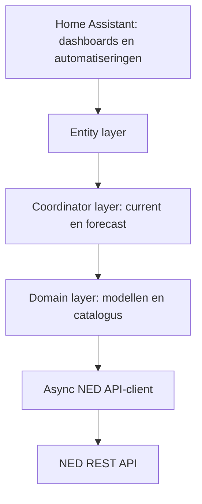
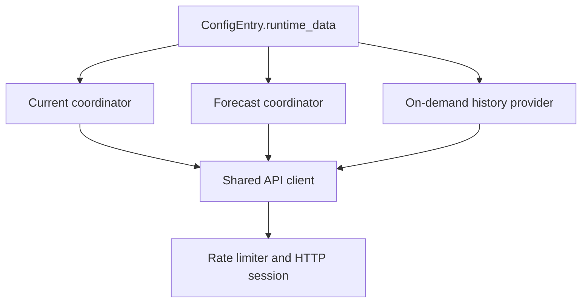

# Integratieplan — Nationaal Energie Dashboard voor Home Assistant

| Eigenschap | Waarde |
| --- | --- |
| Ontwerpversie | 1.0.0 |
| Documentdatum | 24 november 2026 |
| Status | Voorgesteld technisch ontwerp; niet geïmplementeerd |
| Repository | [HiDiHo01/ha-Nationaal-Energie-Dashboard](https://github.com/HiDiHo01/ha-Nationaal-Energie-Dashboard) |
| Doelarchitectuur | Home Assistant Custom Integration |
| Kwaliteitsdoel | Platinum |
| Python | Volgt nieuwste stable Core; momenteel 3.14 (minimum 3.14.2, ontwikkelpin 3.14.10) |
| Minimale Home Assistant Core-versie | 2026.11.3 (stable, 24 november 2026) |
| Distributie | Home Assistant Marketplace (algemene catalogus) |

> Dit document legt het integratieplan vast. Ontwerpkeuzes zijn voorstellen, geen gerealiseerde functionaliteit. API-waarden zijn werkhypothesen totdat de actuele OpenAPI-specificatie, datacatalogus en geauthenticeerde contracttests deze bevestigen. De toepasselijke AGENTS.md en AI_POLICY.md zijn leidend zodra deze bestaan.

## 1. Projectdoelstelling

Ontwikkel een robuuste, schaalbare, volledig asynchrone Home Assistant-integratie voor historische, actuele en voorspelde Nederlandse energiedata, bruikbaar in sensoren, dashboards en automatiseringen. Minimaliseer belasting van de API, de event loop en de Recorder-database.

### 1.1 Technische uitgangspunten

| Onderdeel | Ontwerpkeuze |
| --- | --- |
| Domain | `nationaal_energie_dashboard` |
| Integration type | `service` |
| IoT class | `cloud_polling` |
| Python | Volgt de vastgelegde Core-baseline |
| HTTP-client | aiohttp |
| Authenticatie | API-key |
| Configuratie | Config Flow |
| Aanvullende instellingen | Options Flow |
| Gegevenscoördinatie | DataUpdateCoordinator |
| Datamodellen | Typed dataclasses |
| Tijdverwerking | Timezone-aware UTC |
| Lokale tijdzone NED | Europe/Amsterdam |
| Vertalingen | Nederlands en Engels, gelijkwaardig; Engels native fallback |
| Testframework | pytest |
| Linting | Ruff en Pylint |
| Typecontrole | mypy strict |
| CI/CD | GitHub Actions |
| Distributie | Home Assistant Marketplace (algemene catalogus) |
| Kwaliteitsnorm | Home Assistant Platinum |

Platinum is vanaf het begin een ontwerpcriterium: asynchrone dependency, sessie-injectie, strikte typing en alle toepasselijke lagere kwaliteitscriteria. Er wordt geen officiële certificering geclaimd.

### 1.2 Home Assistant-versiebeleid

De minimale ondersteunde Home Assistant Core-versie is bij iedere nieuwe integratierelease de dan nieuwste stabiele Core-release, inclusief patchnummer. Controleer deze via https://version.home-assistant.io/stable.json en de officiële release-informatie. Gebruik een expliciete versie per release in hacs.json (homeassistant), documentatie en de reproduceerbare testomgeving; verhoog de grens pas voor een nieuwe integratierelease, niet met terugwerkende kracht. Oudere Core-versies, beta's en developmentversies hoeven niet ondersteund te worden. Valideer vóór publicatie installatie en tests tegen de vastgelegde baseline.

De huidige baseline is 2026.11.3, uitgebracht op 23 november 2026, bevestigd via de [stable-versiefeed](https://version.home-assistant.io/stable.json) en [release-informatie](https://www.home-assistant.io/blog/2026/11/04/release-202611/). Runtime- en dependencycompatibiliteit moeten in de ontwikkelomgeving worden gevalideerd.

### 1.3 Python-versiebeleid

De Python-doelversie volgt de major.minor-versie die de nieuwste stabiele Home Assistant Core-release gebruikt. Controleer bij het vaststellen van de Core-baseline de officiële release-tag: pyproject.toml (requires-python en toolversies) en .python-version (exacte ontwikkelversie). Neem de officiële minimale Python-versie over en pin de ontwikkelomgeving op de bijbehorende exacte Python-versie. Gebruik dezelfde major.minor-versie voor Ruff, Pylint, mypy en CI. Herbeoordeel deze waarden bij elke nieuwe integratierelease; pas oudere releases niet met terugwerkende kracht aan. Kies nooit zelfstandig een nieuwere Python-generatie dan de vastgelegde Core-baseline.

Baseline 24 november 2026: Home Assistant Core 2026.11.3, Python 3.14, upstream requires-python >=3.14.2 en ontwikkelversie 3.14.10. Bronnen: [Core pyproject.toml](https://github.com/home-assistant/core/blob/2026.11.3/pyproject.toml) en [Core .python-version](https://github.com/home-assistant/core/blob/2026.11.3/.python-version).

## 2. Functionele scope

### 2.1 Energiedatasets

Actuele gegevens dienen sensoren en automatiseringen; historische tijdreeksen dienen analyse; voorspellingen dienen planning.

| Dataset | Voorgesteld NED Type ID | Prioriteit |
| --- | ---: | --- |
| Windenergie op land | 1 | P0 |
| Zonne-energie | 2 | P0 |
| Windenergie op zee | 51 | P0 |
| Elektriciteitsmix | 27 | P0 |
| CO₂-emissiefactor elektriciteit | 27 | P0 |
| Elektriciteitsverbruik | 59 | P0 |
| Hernieuwbare energie totaal | 0 | P1 |
| Gascentrales | 18 | P1 |
| Steenkool | 19 | P1 |
| Kernenergie | 20 | P1 |
| Gasverbruik lokale distributiebedrijven | 55 | P1 |
| Totaal gasverbruik | 56 | P1 |
| Gasverbruik industrie | 53 | P2 |
| Gasverbruik elektriciteitscentrales | 54 | P2 |
| Elektriciteitsimport | 27 | P2 |
| Elektriciteitsexport | 27 | P2 |
| Gasopslag en gasstromen | 28 | P2 |

P0 is essentieel voor de eerste release, P1 is uitbreiding, P2 is geavanceerde ondersteuning. Type ID alleen is onvoldoende: ook activiteit, geografisch punt, granulariteit, tijdzone en classificatie bepalen de dataset. De officiële datacatalogus is leidend; bevestig iedere combinatie afzonderlijk.

### 2.2 Gebruiksdoeleinden

- Elektrische voertuigen, warmtepompen, boilers en andere energie-intensieve apparaten plannen op basis van beschikbare voorspellingen.
- Nationale elektriciteitsproductie, consumptie en CO₂-intensiteit visualiseren.
- Wind- en zonnevoorspellingen weergeven.
- Regionale productie vergelijken en historische ontwikkelingen analyser.

De integratie levert gegevens en bestuurt geen apparaten. Nationale opwek is geen voorspelling van individuele zonnepanelen of een meting van huishoudelijk verbruik. Een lage CO₂-intensiteit impliceert geen lage stroomprijs.

## 3. API-architectuur

Actuele broncontrole en openstaande verificatiepunten: [API_REFERENCE.md](API_REFERENCE.md). De gedocumenteerde waarden en het opgehaalde OpenAPI-schema zijn geen live contractbewijs. Eerste geauthenticeerde zonne-energieobservaties zijn geslaagd; de nationale UTC-P0-matrix en paginering zijn live bevestigd; NL-kwartierdekking voor historische zon is bevestigd, dagaggregatie-afwijkingen blijven open; zie de vastgelegde veldtype-afwijkingen en resterende vragen in API_REFERENCE.md.

### 3.1 API-verbinding

| Eigenschap | Te verifiëren contract |
| --- | --- |
| Base URL | https://api.ned.nl/v1 |
| Transport | HTTPS |
| Protocol | REST |
| Dataformaat | JSON-LD |
| Authenticatieheader | X-AUTH-TOKEN |
| Accept-header | application/ld+json |
| API-versie | v1 |
| Gedocumenteerde rate limit | 200 requests per 5 minuten |

Bronnen: [API-handleiding](https://ned.nl/nl/handleiding-api), [Swagger](https://api.ned.nl/v1). Bevestig tevens de scope van de rate limit (API-key, account of andere beperking).

### 3.2 Primair endpoint

```http
GET https://api.ned.nl/v1/utilizations
```

### 3.3 Requestparameters

| Parameter | Functie |
| --- | --- |
| point | Geografische locatie |
| type | Energiedrager |
| granularity | Tijdsinterval |
| granularitytimezone | Querytijdzone voor datumfilters en aggregaties; response-ID kan bij kwartierdata afwijken (zie API_REFERENCE.md) |
| classification | Actueel of voorspelling |
| activity | Activiteitstype |
| validfrom[after] | Begin zoekinterval; inclusiviteit verifiëren |
| validfrom[strictly_before] | Exclusief einde zoekinterval |

Centraliseer samenstelling en validatie van parameters in de client; entities bouwen geen requests.

### 3.4 Classificaties

| ID | Enum | Betekenis |
| ---: | --- | --- |
| 1 | FORECAST | Voorspelling |
| 2 | CURRENT | Actuele en historische gegevens |

Historie wordt geselecteerd met een historisch datuminterval, niet als aparte classificatie.

### 3.5 Activiteiten

| ID | Enum |
| ---: | --- |
| 1 | PROVIDING |
| 2 | CONSUMING |
| 3 | IMPORT |
| 4 | EXPORT |
| 5 | STORAGE_IN |
| 6 | STORAGE_OUT |
| 7 | STORAGE |

### 3.6 Granulariteit

| ID | Interval | Implementatie |
| ---: | --- | --- |
| 3 | 10 minuten | Ondersteunen waar beschikbaar |
| 4 | 15 minuten | Standaard |
| 5 | 1 uur | Ondersteunen |
| 6 | 1 dag | Historie en aggregaties |
| 7 | 1 maand | Historie |
| 8 | 1 jaar | Historie |

Bied alleen geldige datasetcombinaties aan. Gebruik kwartierdata als MVP-uitgangspunt; tienminutendata is niet voor alle elektriciteitsdatasets beschikbaar.

### 3.7 Geografische ondersteuning

Nederland (point 0) is standaard. Provincies 1–12 zijn gedocumenteerd voor zon en wind op land. Offshore P0 gebruikt nationaal type 51; types 17 en 22 worden volgens changelog v1.28.0 uitgefaseerd. Bied geen individuele windparken aan zonder nieuw bewijs. Valideer overige locaties en combinaties vóór implementatie.

## 4. Softwarearchitectuur



### 4.1 Architectuurprincipes

Single Responsibility, Separation of Concerns, Dependency Injection, composition over inheritance, immutable datamodellen waar mogelijk. Geen netwerkverzoeken in entity-properties, geen circulaire imports, geen blokkerende I/O en één centrale datasetcatalogus.

De API-client is een zelfstandig Python-package zonder Home Assistant-afhankelijkheid. Ontwikkel, bouw en test het onafhankelijk. Valideer in fase 0 een reproduceerbare Marketplace-compatibele runtime-installatiemethode; eindgebruikers mogen geen ontwikkelaarscheckout nodig hebben. Publieke packagepublicatie vereist toestemming.

## 5. Voorgestelde repositorystructuur

```text
ha-Nationaal-Energie-Dashboard/
├── .github/
│   ├── ISSUE_TEMPLATE/
│   ├── workflows/
│   │   ├── ci.yaml
│   │   ├── baseline-watch.yaml
│   │   ├── python-next-smoke.yaml
│   │   ├── hassfest.yaml
│   │   ├── hacs.yaml
│   │   ├── api-contract.yaml
│   │   └── release.yaml
│   ├── dependabot.yml
│   └── pull_request_template.md
├── custom_components/
│   └── nationaal_energie_dashboard/
│       ├── __init__.py
│       ├── const.py
│       ├── config_flow.py
│       ├── coordinator.py
│       ├── entity.py
│       ├── sensor.py
│       ├── binary_sensor.py
│       ├── models.py
│       ├── descriptions.py
│       ├── diagnostics.py
│       ├── repairs.py
│       ├── services.py
│       ├── services.yaml
│       ├── manifest.json
│       ├── quality_scale.yaml
│       ├── icons.json
│       ├── brand/
│       │   └── icon.png
│       └── translations/
│           ├── en.json
│           └── nl.json
├── packages/
│   └── ned-api/
│       ├── pyproject.toml
│       └── src/
│           └── ned_api/
│               ├── __init__.py
│               ├── client.py
│               ├── const.py
│               ├── enums.py
│               ├── exceptions.py
│               ├── models.py
│               ├── catalog.py
│               ├── parser.py
│               ├── rate_limiter.py
│               └── py.typed
├── tests/
│   ├── api/
│   ├── integration/
│   ├── fixtures/
│   └── conftest.py
├── docs/
│   ├── INTEGRATION_PLAN.md
│   ├── ARCHITECTURE.md
│   ├── API_REFERENCE.md
│   ├── DATASETS.md
│   ├── INSTALLATION.md
│   ├── CONFIGURATION.md
│   ├── ENTITIES.md
│   ├── AUTOMATIONS.md
│   ├── TROUBLESHOOTING.md
│   └── DEVELOPMENT.md
├── LICENSE
├── USAGE_TERMS.md
├── AGENTS.md
├── AI_POLICY.md
├── CONTRIBUTING.md
├── SECURITY.md
├── CHANGELOG.md
├── README.md
├── hacs.json
├── pyproject.toml
├── .pre-commit-config.yaml
├── .gitignore
└── .editorconfig
```

### 5.1 Verantwoordelijkheden

| Module | Verantwoordelijkheid |
| --- | --- |
| client.py | Asynchrone HTTP-communicatie |
| catalog.py | Geldige datasetcombinaties |
| enums.py | API-parameterwaarden |
| parser.py | Responsevalidatie en normalisatie |
| rate_limiter.py | Requestbudget en throttling |
| coordinator.py | Updates, caching en beschikbaarheid |
| entity.py | Gedeeld entity-gedrag |
| sensor.py | Sensorimplementaties |
| descriptions.py | Declaratieve entity-definities |
| config_flow.py | Configuratie en authenticatie |
| diagnostics.py | Geredigeerde diagnostiek |
| repairs.py | Gebruikersgerichte herstelacties |
| services.py | Historie en voorspellingen |
| quality_scale.yaml | Traceerbaarheid kwaliteitscriteria |

Voeg modules pas toe bij een concrete verantwoordelijkheid; vermijd lege placeholders. Ship translations/en.json en translations/nl.json direct; geen strings.json voor de custom integratie. Gebruikershandleidingen worden per taal gepaard onder docs/user/nl en docs/user/en; README.md en README.en.md zijn de tweetalige ingang. Valideer de vertaal- en manifestbestanden voor de gekozen Home Assistant- en HACS-versies.

## 6. Datamodellen

| Model | Functie |
| --- | --- |
| DatasetKey | Unieke datasetidentificatie |
| DatasetDefinition | Eigenschappen en beperkingen |
| EnergyRecord | Genormaliseerd API-record |
| EnergySeries | Geordende tijdreeks |
| DatasetSnapshot | Datastatus per dataset |
| CoordinatorData | Coordinator-snapshot |
| NedRuntimeData | Runtime-objecten van de config entry |

### 6.1 Datasetidentificatie

```python
from dataclasses import dataclass


@dataclass(frozen=True, slots=True, kw_only=True)
class DatasetKey:
    """Identify a unique NED energy dataset."""

    type_id: int
    point_id: int
    activity_id: int
    granularity_id: int
    classification_id: int
    granularity_timezone_id: int
```

### 6.2 Genormaliseerd energierecord

```python
from dataclasses import dataclass
from datetime import datetime


@dataclass(frozen=True, slots=True, kw_only=True)
class EnergyRecord:
    """Represent a normalized NED energy interval."""

    dataset: DatasetKey
    valid_from: datetime
    valid_to: datetime
    last_update: datetime | None = None
    capacity_kw: float | None = None
    volume_kwh: float | None = None
    emission_kg: float | None = None
    emission_factor_kg_kwh: float | None = None
    utilization_ratio: float | None = None
```

De parser valideert bronwaarden en catalogusreferenties; dataclasses bevatten genormaliseerde gegevens. De veldnamen zijn interne ontwerpkeuzes, geen letterlijk API-contract.

### 6.3 Datavalidatie

| Situatie | Verwerking |
| --- | --- |
| null | Ontbrekende waarde behouden |
| Numerieke nul | Geldige waarde |
| NaN of oneindig | Afwijzen |
| Ontbrekend optioneel veld | None |
| Ongeldige tijdstempel | Record afwijzen |
| Tijdstempel zonder tijdzone | Afwijzen tenzij contract eenduidig is |
| Ongeldig geldigheidsinterval | Record afwijzen |
| Dubbele records | Dedupliceren |
| Ongeordende records | Chronologisch sorteren |
| Historische revisie | Nieuwste geldige versie verwerken |
| Onbekend extra JSON-veld | Negeren |
| Ontbrekende verplichte structuur | Gecontroleerde API-fout |

Negatieve waarden zijn niet generiek ongeldig. Valideer ze per dataset en metriek.

## 7. Asynchrone NED API-client

```python
from aiohttp import ClientSession


class NedApiClient:
    """Provide asynchronous access to the NED API."""

    def __init__(self, api_key: str, session: ClientSession) -> None:
        """Initialize the client with a shared HTTP session."""
        if not api_key.strip():
            raise ValueError("A non-empty NED API key is required.")

        self._api_key = api_key.strip()
        self._session = session
```

Home Assistant injecteert de sessie via `homeassistant.helpers.aiohttp_client.async_get_clientsession`. De API-client sluit een geleende sessie niet zelf.

### 7.1 Publieke clientinterface

| Methode | Functie |
| --- | --- |
| async_validate_connection() | Bereikbaarheid en authenticatie |
| async_get_utilizations() | Algemene tijdreeks |
| async_get_current() | Actuele gegevens |
| async_get_forecast() | Voorspellingen |
| async_get_history() | Historische gegevens |
| async_get_supported_datasets() | Datasetdefinities |

### 7.2 Requestpipeline

1. Valideer invoer en datasetcombinatie.
2. Controleer het beschikbare requestbudget.
3. Voer HTTP-request met timeout uit.
4. Controleer HTTP-status en responseformaat.
5. Verwerk eventuele paginering veilig en begrensd.
6. Normaliseer en valideer records.
7. Dedupliceer en sorteer.
8. Retourneer getypeerde resultaten.

Interne methoden beginnen met een underscore, bijvoorbeeld _async_request(), _async_fetch_pages() en _parse_record(). Bevestig het pagineringscontract en sta alleen veilige, toegestane NED-next-links toe. Stuur credentials nooit naar externe hosts.

## 8. Pollingstrategie en rate limiting

### 8.1 Voorgestelde intervallen

| Datatype | Update-interval |
| --- | --- |
| Actuele gegevens | 5 minuten |
| Voorspellingen | 60 minuten |
| Dagaggregaties | 60 minuten, indien gebruikt |
| Datasetcatalogus | 24 uur, indien via API opgehaald |
| Historie | Op aanvraag |
| Diagnostics | Geen zelfstandig request |

Stel deze waarden bij op basis van de werkelijke publicatiefrequentie en contracttests.

### 8.2 Belastingsmodel

Zonder batching, retries of handmatige requests, met C actuele datasets, F forecastdatasets, intervallen Ic en If in minuten en P pagina's per opvraging:

- Requests per uur: P × (C × 60/Ic + F × 60/If).
- Conservatieve periodieke piek per vijf minuten: P × (C × ceil(5/Ic) + F × ceil(5/If)).
- Voorbeeld: vijf actuele datasets per vijf minuten, vijf forecastdatasets per uur en één pagina geven 65 requests per uur en maximaal circa tien periodieke requests per vijf minuten.

Dit is een planningsmodel, geen garantie. Werkelijke pieken hangen ook af van retries, initiële setup, handmatige actions, paginering en andere clients die hetzelfde budget gebruiken.

### 8.3 Optimalisatie

- Gedeelde requests voor meerdere metrics uit één dataset.
- Batching uitsluitend na contractvalidatie.
- Concurrency standaard drie gelijktijdige requests.
- Requestdeduplicatie en caching.
- Begrensde exponential backoff met jitter en respect voor Retry-After.
- Intern budget maximaal 120 requests per vijf minuten tegenover de te bevestigen API-limiet van 200.
- Geen periodieke polling voor uitgeschakelde, ongebruikte datasets.
- Eén centrale limiter voor alle requests, inclusief retries, setup en paginering.

## 9. DataUpdateCoordinator



### 9.1 NedCurrentCoordinator

Actuele en recent afgesloten intervallen, actuele sensoren, staleness en ontbrekende gegevens.

### 9.2 NedForecastCoordinator

Forecasttijdreeksen, geselecteerde forecast-sensoren en samenvattingen.

### 9.3 Historische dataprovider

Op aanvraag; geen onbeperkte lokale historische database of aparte periodieke coordinator.

### 9.4 Coordinatoroptimalisaties

Gebruik CoordinatorEntity, always_update=False wanneer snapshotvergelijking betrouwbaar is, entity-contexten, async_config_entry_first_refresh() voor essentiële gegevens en getypeerde snapshots. Isoleer gedeeltelijke datasetuitval. Statuswijzigingen moeten een entity-update veroorzaken, ook als de numerieke waarde niet verandert.

## 10. Config Flow en Options Flow

### 10.1 Eerste configuratie

Voorgestelde invoer: API-key (gemaskeerd), Nederland als standaardlocatie, kwartiergranulariteit en P0-datasets (zon, wind op land, wind op zee, elektriciteitsproductie, verbruik en CO₂-emissiefactor). Valideer de key met een beperkt bekend geldig request; een lege dataset betekent niet automatisch ongeldige authenticatie.

### 10.2 Config entry

Eén config entry voor de dienst, met meerdere regio's en datasets. Voorkom duplicaten.

| Instelling | Opslag |
| --- | --- |
| API-key | ConfigEntry.data |
| Datasets, regio's, granulariteit | ConfigEntry.options |
| Polling en forecastinstellingen | ConfigEntry.options |
| Client en coordinators | ConfigEntry.runtime_data |
| Tijdreekscache | Runtimegeheugen |

### 10.3 Options Flow

Aanpassen van datasets, regio's, forecastfunctionaliteit en begrensde pollingintervallen.

### 10.4 Reauthentication Flow

Start native herauthenticatie bij bevestigde authenticatiefout. Valideer de nieuwe key, update en reload de bestaande entry zonder duplicaten of gewijzigde unique IDs.

### 10.5 Reconfiguration Flow

Ondersteun wijziging van primaire configuratie; behoud entity registry-instellingen.

## 11. Sensorarchitectuur

Gebruik declaratieve SensorEntityDescription-definities met een gedeelde sensorklasse.

### 11.1 Eerste entities

Op eigenaarsopdracht van 25 november 2026 krijgen de volgende acht nationale sensoren voorrang. Dit is een functionele scope en geen vrijgave van de fasepoorten of bevestiging van onbewezen contractgedrag. Andere geplande sensoren blijven latere uitbreidingen volgens hun fase en prioriteit.

| Prioriteit | Sensor | Type / activity / classification | Bronmetriek | Native eenheid / weergave | Fase |
| ---: | --- | --- | --- | --- | ---: |
| 1 | CO₂-intensiteit | 27 / 1 / 2 | emissionfactor | g/kWh | 3 |
| 2 | CO₂-intensiteit voorspelling | 27 / 1 / 1 | emissionfactor | g/kWh | 4 |
| 3 | Geschat aandeel hernieuwbare elektriciteitsproductie | 1, 2, 51, 25, 21 / 1 / 2; noemer 27 | volume, zelfde interval | % | 3, na toepasselijk contractbewijs |
| 4 | Zonne-energieproductie | 2 / 1 / 2 | capacity | kW / MW | 3 |
| 5 | Windenergieproductie op land | 1 / 1 / 2 | capacity | kW / MW | 3 |
| 6 | Windenergieproductie op zee | 51 / 1 / 2 | capacity | kW / MW | 3 |
| 7 | Nationaal elektriciteitsverbruik | 59 / 2 / 2 | capacity | kW / MW | 3 |
| 8 | Nationale elektriciteitsproductie | 27 / 1 / 2 | capacity | kW / MW | 3 |

Gebruik point 0, granularity 4 en granularitytimezone 0 voor de vijf huidige P0-datasets; alle metrieken zijn onderworpen aan de toepasselijke contractacceptatie. Deel de type-27-current-snapshot tussen productie en CO₂-intensiteit. Gebruik een afzonderlijke forecastcoordinator. Als ontwerpkeuze is de forecastsensor de intensiteit van het eerstvolgende volledige kwartier vanaf nu; accepteer uitsluitend het exacte toekomstige doelinterval met classification 1. Publiceer de geldigheidsgrenzen als kleine attributen; de volledige tijdreeks blijft een begrensde response action. Geen state class voor forecast en geen fallback naar current. Ontbrekende of ongeldige data leiden tot unavailable, niet tot nul of een ongeoorloofde interpolatie. Bij de huidige sensoren is current geen garantie op gemeten waarden. Gebruik de vastgelegde stale-dataregels.

**Sensor 3 — geschat aandeel hernieuwbare elektriciteitsproductie (eigenaarsopdracht 25 november 2026).** Kies een expliciet gelabelde schatting die aansluit bij de indeling van het [NED-maandoverzicht oktober 2026](https://ned.nl/nl/achtergrond/maandoverzicht-energiedata-oktober-2026): zon, wind, bijstook van biomassa en het biogene aandeel van afvalelektriciteit. Voor hetzelfde volledige UTC-kwartier geldt:

```text
renewable_share = 100 * (V1 + V2 + V51 + V25 + 0.53 * V21) / V27
```

Alle V-waarden zijn de oorspronkelijke intervalvolumes in kWh, point 0, activity 1, classification 2, granularity 4 en granularitytimezone 0. De voorlopige factor 0.53 is de op twee decimalen afgeronde verhouding van 1988 miljoen kWh hernieuwbare elektriciteit tot 3751 miljoen kWh bruto-elektriciteitsproductie uit afvalverbrandingsinstallaties in 2025 (CBS [StatLine 82004NED](https://www.cbs.nl/nl-nl/cijfers/detail/82004NED), [Hernieuwbare energie in Nederland 2025, §8.5, tabellen 8.3–8.4](https://dashboards.cbs.nl/longreads/2026/hernieuwbare-energie-in-nederland-2025/H8_biomassa.html); geraadpleegd 25 november 2026). Gebruik dit als vaste, gedocumenteerde projectbenadering voor 2026, niet als gegarandeerde NED-fractie of kwartiermeting. Controleer bij een nieuwe jaarlijkse bronpublicatie de factor en versie; geen stilzwijgende wijziging van reeds gepubliceerde historische waarden. Leg methodeversie, factor en bronjaar vast in kleine sensorattributen; NL/EN-naam moet de schatting aangeven.

Volgens de [NED-definities](https://ned.nl/nl/definities) omvat type 25 bijstook, type 21 gemengd afval en type 26 overige elektriciteit met onder meer waterkracht en biomassa/biogas-WKK. Type 26 en andere niet afzonderlijk toegerekende hernieuwbare fracties blijven buiten deze schatting; deze is daarom geen volledige officiële hernieuwbare fractie en ook geen gegarandeerde ondergrens. Type 0 omvat warmte en elektriciteit en wordt uitgesloten. Gebruik offshore 51 in plaats van oude 22/17. Geen percentage (benuttingsgraad), verbruik, import/export, kernenergie of capacity als teller of noemer. Breid de methode alleen uit bij aangetoonde niet-overlappende brondefinities.

Hergebruik actuele snapshots van 1/2/51/27; voeg alleen de twee benodigde huidige datasets 21/25 toe wanneer sensor 3 actief is en het contract dit toelaat. Kies het nieuwste volledig afgesloten, gemeenschappelijke geldige kwartier binnen de vastgelegde stale-grens; controleer dimensies, exacte UTC-grenzen, revisies, eindige niet-negatieve volumes, positieve V27 en dat de ongewogen som van de geselecteerde onderscheiden deelbronnen V27 niet overschrijdt. Geen extrapolatie, vermenging van classificaties, nulvulling, automatische afkapping of historische fallback buiten de stale-grens. Ontbrekende/ongeldige invoer resulteert in unavailable. Publiceer ongeronde berekening als native waarde en aanbevolen weergaveprecisie één decimaal. Test o.a. synthetische volumes 200, 300, 100, 50, 100, 1000 (in formulevolgorde): 70.3%; echte nul, nulnoemer, ontbrekende bron, negatieve/niet-eindige waarde, afwijkende intervallen, revisies en ongeldige bronmix. Valideer bij afzonderlijk geautoriseerd contractonderzoek 21/25 en gezamenlijke dekking van alle zes bronnen. De schattingskeuze vervangt de eis van een volledige officiële bronmix voor deze specifiek gelabelde sensor, niet de noodzakelijke bronvalidatie of de BL-003-fasepoort; geen productie-implementatie of live-aanvragen in deze documentatiewijziging.

De [herhaalde semantiekprobe van 25 november](https://github.com/HiDiHo01/ha-Nationaal-Energie-Dashboard/actions/runs/45507580188/job/138846666702) ondersteunt de eerdere waarnemingen voor dezelfde tijdvakken; de open voorwaarden in [API_REFERENCE.md](API_REFERENCE.md) blijven gelden. Geen live-aanroepen of publicatie zonder toepasselijke autorisatie.

### 11.2 Sensorclassificaties

| Sensortype | Eenheid | Device class | State class |
| --- | --- | --- | --- |
| Actueel vermogen | kW | POWER | MEASUREMENT |
| Energie per interval | kWh | ENERGY | Geen in MVP |
| Energie per dag | kWh | ENERGY | Geen in MVP |
| CO₂-uitstoot per interval | kg | WEIGHT | Geen |
| CO₂-intensiteit | g/kWh | Geen | MEASUREMENT |
| Benuttingsgraad | % | Geen | MEASUREMENT |
| Geschat aandeel hernieuwbare elektriciteitsproductie | % | Geen | MEASUREMENT |
| Voorspeld vermogen | kW | POWER | Geen |
| Voorspelde energie | kWh | ENERGY | Geen |
| Voorspelde CO₂-intensiteit | g/kWh | Geen | Geen |
| Laatste bronupdate | Timestamp | TIMESTAMP | Geen |
| Voorspeld optimaal tijdstip | Timestamp | TIMESTAMP | Geen |

Valideer deze classificaties tegen de actuele Home Assistant-sensorregels. Intervalvolumes zijn niet automatisch TOTAL_INCREASING. Forecasts zijn geen actuele metingen voor long-term statistics.

### 11.3 Entity naming

Gebruik has_entity_name=True en vertaalbare descriptions. Illustratieve entity-ID's (Home Assistant genereert deze; gebruiker kan ze wijzigen):

```text
sensor.ned_nederland_solar_power
sensor.ned_nederland_wind_onshore_power
sensor.ned_nederland_wind_offshore_power
sensor.ned_nederland_electricity_production
sensor.ned_nederland_electricity_consumption
sensor.ned_nederland_co2_intensity
sensor.ned_nederland_co2_intensity_forecast
sensor.ned_nederland_renewable_electricity_share
sensor.ned_nederland_solar_forecast_today
sensor.ned_nederland_solar_forecast_tomorrow
```

### 11.4 Unique ID

```text
{entry_id}_{point_id}_{type_id}_{activity_id}_{granularity_id}_{timezone_id}_{classification_id}_{metric}
```

Behoud stabiele IDs bij restart, reload en keywijziging. Gebruik voor de samengestelde hernieuwbare-aandeelsensor een stabiele unieke ID op basis van entry, point, granulariteit, tijdzone, classificatie en een vaste afgeleide metrieknaam (geen fictief NED-type-ID en geen dynamische lijst van brontypen in de ID). Leg migraties vast wanneer de identificatiestrategie verandert.

### 11.5 Device Registry

Groepeer logische serviceapparaten per geografisch gebied: Nederland, Noord-Holland en overige geselecteerde regio's. Het zijn logische clouddienstgroeperingen, geen fysieke apparaten.

## 12. Eenheden en energieberekeningen

### 12.1 Vermogen en energie

Energie (kWh) = gemiddeld vermogen (kW) × intervalduur (uur). Bijvoorbeeld 1.000 kW gedurende 15 minuten = 250 kWh. Gebruik geldig API-volume als primaire bron. De [NED-definities](https://ned.nl/nl/definities) bevestigen capacity = 4 × volume voor kwartierdata; de [live-semantiekprobe](API_REFERENCE.md#live-resultaat-scope-semantics--24-november-2026) toont echter 32 afwijkingen groter dan 3 kW op 576 records (SEM-001). Behoud capacity en volume onafhankelijk; geen afkeur of automatische correctie op basis van diagnostische grenzen. Bereken alleen een fallback indien de veldsemantiek dit rechtvaardigt.

### 12.2 CO₂-emissiefactor

g/kWh = kg/kWh × 1.000. Voorbeeld: 0,184 kg/kWh = 184 g/kWh. Ontbrekende intensiteit is geen nul; controleer de betekenis van de productie- of consumptiemix. De handleiding noemt emission in kg, het OpenAPI-schema in ton; vergelijk uitsluitend positieve waarden van type 27 met volume × emissionfactor als diagnostische hypothese. De live-probe ondersteunt kg voor alle 192 positieve type 27-records (SEM-002), geen ton-overeenkomst. Formele eenheid en afronding blijven open; geen automatische kg/ton-conversie of emissietotaal zolang de vereiste contractbevestiging ontbreekt. Niet-toepasselijke emissies en type 59-percentage niet als bewezen nulmetingen tonen.

### 12.3 Gewogen gemiddelde

I_gewogen = som(E_i × I_i) / som(E_i), waarbij E_i het bijbehorende energievolume is. Vereis geldige dekking en een niet-nul noemer. Een gewoon rekenkundig gemiddelde is niet altijd representatief.

### 12.4 Benuttingsgraad

Converteer een eenheidsloze ratio naar procenten na contractvalidatie. Benuttingsgraad is niet hetzelfde als aandeel van een energiebron in de totale productie.

### 12.5 Energy Dashboard

Registreer nationale productie niet als huishoudelijk verbruik of eigen zonnepanelenproductie. Beloof geen directe CO₂-integratie met het Energy Dashboard voordat semantische en technische compatibiliteit is vastgesteld.

## 13. Forecast Engine

De actuele productiecatalogus en changelog v1.23.0 documenteren voor de P0-datasets een horizon tot zeven dagen, inclusief productiemix en CO₂. Gebruik de daadwerkelijk ontvangen tijdreeks en dekking; verifieer de horizon per dataset.

### 13.1 Forecastfuncties

| Functie | Resultaat |
| --- | --- |
| Huidig interval | Verwachte waarde |
| Volgend uur | Verwachte gemiddelde waarde |
| Vandaag/morgen | Verwacht dagvolume |
| Maximum/minimum komende 24 uur | Hoogste/laagste waarde |
| Tijdstip maximum/minimum | Timestamp |
| Laagste CO₂-periode | Gunstig beschikbaar tijdvenster |
| Duurzame productieperiode | Hoge verwachte opwek |
| Forecastdekking | Beschikbare intervallen |

### 13.2 Visualisatie

Toon een tijdreeks van CO₂-intensiteit in g/kWh met het geselecteerde gunstige venster. Voorbeeld met fictieve waarden: minimum 71 g/kWh en een venster rond het middaguur. Gebruik geen illustratieve waarden als echte sensorwaarden.

### 13.3 Optimalisatiealgoritme

Selecteer het aaneengesloten toekomstige tijdvenster met de laagste verwachte intensiteit voor de gevraagde looptijd. Bij gelijkwaardige uitkomsten kiest het algoritme het vroegste venster. Houd rekening met ontbrekende intervallen, intervalduur, verstreken forecasts en DST. Voor variabel apparaatvermogen wordt gewogen op verwacht energieverbruik; bij constant vermogen volstaat een tijdgewogen gemiddelde.

Illustratieve reeks uurwaarden in g/kWh:

```text
244, 235, 221, 205, 186, 175, 165, 148, 124, 98, 71, 74,
81, 90, 112, 136, 172, 198, 231, 257, 248, 236, 227, 219
```

De gunstigste drie opeenvolgende voorbeelduren zijn 10:00–13:00, gemiddeld 75,3 g/kWh. Dit is uitsluitend een fictief rekenvoorbeeld, geen actueel advies. Prijsoptimalisatie valt buiten scope.

## 14. Home Assistant Actions

Gebruik response data voor omvangrijke tijdreeksen in plaats van honderden attributen in Recorder.

| Action | Prioriteit | Functie |
| --- | --- | --- |
| get_forecast | P0 | Voorspelde tijdreeks |
| get_history | P1 | Historische tijdreeks |
| get_optimal_period | P1 | Optimaal tijdvenster |
| get_datasets | P1 | Ondersteunde datasets |

Registreer actions in async_setup() met SupportsResponse.ONLY, gevalideerde invoer en expliciete geldige config_entry_id wanneer de action entrygebonden is. Begrens datumbereiken, responsegrootte en requestbudget.

### 14.1 Voorbeeld

```yaml
action: nationaal_energie_dashboard.get_forecast
data:
  config_entry_id: "<config_entry_id>"
  dataset: electricity_mix
  metric: emission_factor
  point_id: 0
  hours: 24
response_variable: ned_forecast
```

### 14.2 Voorgesteld responsecontract

```json
{
  "dataset": "electricity_mix",
  "metric": "emission_factor",
  "classification": "forecast",
  "unit": "g/kWh",
  "point_id": 0,
  "complete": true,
  "records": [
    {
      "valid_from": "2026-11-25T08:00:00+00:00",
      "valid_to": "2026-11-25T08:15:00+00:00",
      "value": 158.2
    },
    {
      "valid_from": "2026-11-25T08:15:00+00:00",
      "valid_to": "2026-11-25T08:30:00+00:00",
      "value": 152.4
    }
  ]
}
```

Fictief, verkort voorbeeld van het interne contract, niet een letterlijke NED-response. In productie moet complete de werkelijk aangevraagde horizon beschrijven.

## 15. Tijdzonebeheer en historie

Gebruik timezone-aware datetimes:

```python
from datetime import datetime, timezone

now = datetime.now(timezone.utc)
```

Onderscheid UTC-tijdstempels, Home Assistant-gebruikerstijdzone, querytijdzone en response-tijdzone. De [live-observaties](API_REFERENCE.md#vervolgobservaties-tijdzones--24-november-2026) bevestigen voor nationale historische zonne-energie dat querytijdzone 1 bij kwartierdata records met ID 0 en correcte Nederlandse 23-, 24- en 25-uurskalendergrenzen geeft. Houd beide tijdzoneconcepten gescheiden. De gerichte live-dagprobe bevestigt voor 25 oktober 2026 een NL-daginterval van 24 in plaats van 25 uur, met een correct begin en een einde 3600 s te vroeg (TZ-002). Voor 22 november 2026 retourneert de UTC-dagquery één interval van 24 uur, maar beide grenzen liggen 82800 s te laat (TZ-003). Zie [run 45478763623](https://github.com/HiDiHo01/ha-Nationaal-Energie-Dashboard/actions/runs/45478763623/job/138745945524) en de contractreferentie; de oorzaken en meetsemantiek zijn niet vastgesteld. Gebruik API-dagaggregaten niet voor berekeningen zolang deze afwijkingen (TZ-002/TZ-003) niet zijn opgehelderd. Baseer Nederlandse kalenderberekeningen op volledig gevalideerde kwartierintervallen en bevestigde meetsemantiek; pas upstream-tijdstempels niet stilzwijgend aan. Andere datasets en granulariteiten blijven afzonderlijk te verifiëren.

### Vastgelegd implementatiebesluit: lokale kalenderaggregatie uit UTC-kwartierdata

Besluit 24 november 2026, bevestigd door de eigenaar: gebruik `granularity=4` (15 minuten) en standaard `granularitytimezone=0` voor productieaanvragen. Bewaar timezone-aware intervalgrenzen intern in UTC. Bereken de Nederlandse kalenderdag met `ZoneInfo("Europe/Amsterdam")`: construeer de lokale middernacht van de gevraagde datum en de lokale middernacht van de volgende kalenderdatum afzonderlijk en converteer beide naar UTC. Gebruik het halfopen interval [begin, einde); tel geen vaste 24 uur op bij de UTC-start.

- Vraag alle UTC-kalenderdagen op die het gewenste interval overlappen; gebruik de gevalideerde datumfilters en begrensde paginering. Selecteer vervolgens uitsluitend kwartierintervallen die volledig binnen de gewenste UTC-grenzen vallen. Een Nederlandse dag is niet gelijk aan één UTC-kalenderdag. Hergebruik overlappende queries via de bestaande cache en requestlimiter.
- Valideer datasetdimensies, classificatie, werkelijke intervalgrenzen, duur van 15 minuten, chronologische aaneensluiting en volledige dekking; dedupliceer revisies volgens het revisiebeleid. Detecteer gaten, overlap en ongeldige waarden. Een gelijke telling alleen volstaat niet.
- Bereken eigen dagaggregaties uitsluitend uit gevalideerde kwartierwaarden met bevestigde meetsemantiek. Som geldige intervalvolumes (kWh); gebruik voor andere metrieken alleen de passende bewezen aggregatiemethode. Vul ontbrekende of null-waarden niet met nul; rapporteer onvolledige dekking en publiceer geen onbewezen volledig dagtotaal. Houd historie/current en forecasts gescheiden.
- Gebruik geen upstream-dagaggregatie (`granularity=6`) voor productie zolang TZ-002/TZ-003 niet zijn opgehelderd. Verander geen ontvangen tijdstempels. Querytijdzone 1 is voor de geteste historische zonnekwartieren bevestigd, maar is niet de gekozen standaard voor productie.
- Voeg bij implementatie offline regressietests toe voor normale dagen, beide DST-overgangen, UTC-dagoverlap, grensselectie, revisies, gaten, overlap, null versus nul en gescheiden classificaties. Valideer de gekozen queryvorm en meetsemantiek per dataset voordat deze in productie wordt gebruikt.

Dit is een architectuurbesluit, geen geïmplementeerde of volledig gevalideerde functie. De nationale UTC-P0-kwartierqueries zijn bevestigd voor de onderzochte tijdvakken; de samengestelde lokale kalenderaggregatie, overige combinaties en meetsemantiek blijven acceptatievoorwaarden. Zie [API_REFERENCE.md](API_REFERENCE.md) en BL-003 in [BACKLOG.md](BACKLOG.md).

| Nederlandse kalenderdag | Uren | Kwartierintervallen |
| --- | ---: | ---: |
| Normaal | 24 | 96 |
| Ingang zomertijd | 23 | 92 |
| Ingang wintertijd | 25 | 100 |

Gebruik geen vaste 96 records per dag. Dedupliceer historische revisies op dataset en geldigheidsinterval. Gebruik lastupdate voor revisieselectie, maar beschouw een wijziging van lastupdate niet automatisch als gewijzigde meetwaarde. Vervang oudere records; tel revisies niet op.

## 16. Foutafhandeling en beschikbaarheid

### 16.1 Exception hierarchy

```text
NedApiError
├── NedAccessDeniedError
├── NedAuthenticationError
├── NedPermissionError
├── NedConnectionError
├── NedTimeoutError
├── NedRateLimitError
├── NedResponseError
├── NedValidationError
└── NedUnsupportedDatasetError
```

### 16.2 HTTP-foutafhandeling

| Situatie | Gedrag |
| --- | --- |
| 200 | Response valideren |
| 400 | Requestfout, geen retry |
| 401 | Authenticatieprobleem |
| 403 | Toegang geweigerd; controleer credentials en rechten; geen automatische reauth |
| 404 | Endpoint of dataset controleren |
| 429 | Throttling en backoff |
| 500–599 | Tijdelijke storing, begrensde retry |
| Timeout/DNS | Tijdelijke verbindingsfout |
| Ongeldige JSON | Responsefout |
| Lege tijdreeks | Afzonderlijke datastatus |
| Coroutine geannuleerd | Annulering doorgeven |

AUTH-001/002/003/005: drie door eigenaar gerapporteerde observaties voor dezelfde historische nationale zonnequery (zie [API_REFERENCE.md](API_REFERENCE.md#handmatige-authenticatieobservaties--25-november-2026)). Conceptmapping: 401 naar NedAuthenticationError, 403 naar onafhankelijke NedAccessDeniedError; 403 is ook waargenomen bij een ongeldige key en is geen bewijs van onvoldoende rechten. Geen automatische reauth bij 403. AUTH-004 (rechten) en 429/Retry-After blijven open; overige tabelregels zijn ontwerp, geen bewezen NED-contract.

### 16.3 Home Assistant-mapping

| Situatie | Mechanisme |
| --- | --- |
| Tijdelijke setupfout | ConfigEntryNotReady |
| Bevestigde authenticatiefout | ConfigEntryAuthFailed |
| Mislukte periodieke update | UpdateFailed |
| Ongeldige action-invoer | ServiceValidationError |
| Operationele action-fout | HomeAssistantError |
| Langdurig herstelbaar probleem | Repair issue |

### 16.4 Datastatus

Actueel → tijdelijk verouderd → unavailable bij verstreken geldigheid; automatisch herstel na succesvolle update. Respecteer native coordinatorbeschikbaarheid. Bewaar eventueel de laatste succesvolle waarde intern, maar presenteer verouderde data niet ongemerkt als actueel. Controleer leeftijd en geldigheid per dataset.

## 17. Beveiliging, privacy en logging

HTTPS en certificaatvalidatie verplicht. Geen API-key in URL, logging, diagnostiek of GitHub. Verbied onveilige redirects, begrens timeout, responsegrootte en pagina's, valideer invoer en scan dependencies. Gebruik het reguliere config-entrymechanisme; beweer niet dat secrets automatisch versleuteld op schijf zijn.

### 17.1 Logging

Gebruik lazy formatting, geen f-strings in loggingcalls:

```python
_LOGGER.debug(
    "Retrieved %s records for dataset %s",
    record_count,
    dataset_key,
)
```

DEBUG: requestduur, dataset, recordaantallen. INFO: operationele statuswijzigingen. WARNING: herstelbare afwijkingen. ERROR: ernstige operationele fouten. Voorkom herhaalde logspam.

### 17.2 Diagnostics

Versie, geselecteerde datasets, update-intervallen, laatste succesvolle update, recordaantallen, datadekking en rate-limiterstatus. Redigeer API-keys, headers, accountgegevens en onbewerkte exceptions die credentials kunnen bevatten.

## 18. Home Assistant Platinum Quality Scale

De officiële schaal is cumulatief. Leg alle toepasselijke criteria vast volgens de actuele officiële documentatie.

| Niveau | Belangrijkste oplevercriteria |
| --- | --- |
| Bronze | Config flow, authenticatievalidatie, unieke entries/entities, runtime data, polling, basisdocumentatie |
| Silver | Reload/unload, reauth, beschikbaarheid, concurrency, testdekking |
| Gold | Diagnostics, vertalingen, relevante repairs, reconfiguratie, registry, gebruikersdocumentatie |
| Platinum | Asynchrone dependency, sessie-injectie, strikte typing |

### 18.1 quality_scale.yaml

Ieder toepasselijk criterium heeft een onderbouwde status done, todo of exempt; controleer de actuele bestandsstructuur en syntaxis. Motiveer uitzonderingen, bijvoorbeeld discovery van fysieke apparaten voor deze clouddienst. Deze tabel is een samenvatting, geen volledige officiële criterialijst. Platinum is een intern aantoonbaar kwaliteitsdoel, geen automatisch toegekende certificering.

## 19. Teststrategie

Testpiramide: brede unit tests voor API, modellen, parser en berekeningen; Home Assistant-integratietests voor lifecycle en entities; beperkte opt-in live API-contracttests.

### 19.1 Interne streefdekking

| Onderdeel | Streefdekking |
| --- | ---: |
| Config Flow | 100% |
| API-client, parser, modellen | ≥95% |
| Forecastberekeningen | 100% |
| Coordinator, sensors, services | ≥95% |
| Diagnostics | 100% |
| Totale branch coverage | ≥95% |

Dit zijn projectdoelen, niet allemaal officiële Platinum-drempels.

### 19.2 Testacceptatiechecklist

API-client:

- [ ] Geldige API-response.
- [ ] Ongeldige authenticatie.
- [ ] Timeout en verbindingsverlies.
- [ ] HTTP 429 en Retry-After.
- [ ] Paginering en onveilige next-links.
- [ ] Malformed JSON en ontbrekende velden.
- [ ] Requestbudget bij concurrency.
- [ ] Annulering van requests.

Home Assistant:

- [ ] Succesvolle config flow.
- [ ] Dubbele config entry voorkomen.
- [ ] Setup bij onbereikbare API.
- [ ] Reauth en reconfigure.
- [ ] Reload en unload.
- [ ] Entity unique IDs behouden.
- [ ] Gedeeltelijke datasetuitval.
- [ ] Automatisch herstel.

Datakwaliteit:

- [ ] Ontbrekende waarden versus nul.
- [ ] Duplicaten en historische revisies.
- [ ] Ongesorteerde tijdreeksen.
- [ ] Eenheidsconversies.
- [ ] Zomer- en wintertijd.
- [ ] Onvolledige forecast.
- [ ] Gewogen CO₂-gemiddelde.
- [ ] Optimale aaneengesloten tijdvensters.

Security en kwaliteit:

- [ ] API-keyredactie.
- [ ] Geen blokkerende I/O.
- [ ] Strict typing.
- [ ] HACS-validatie.
- [ ] Hassfest-validatie.
- [ ] Dependency scanning.
- [ ] Geen achterblijvende async-taken.

Reguliere CI gebruikt reproduceerbare fixtures en gemockte responses zonder persoonlijke API-key. Live contracttests zijn gescheiden, opt-in, begrensd en gebruiken veilig geïnjecteerde credentials.

### 19.3 Forward Compatibility Testing

- De Home Assistant/Python-baseline blijft leidend voor productiecode, linting, strict typing, volledige integratietests en de verplichte coveragepoorten.
- Onderhoud de afzonderlijke workflow python-next-smoke.yaml voor de eerstvolgende Python-major.minor-generatie (momenteel 3.15, productie 3.14). Deze experimentele job is niet releaseblokkerend (continue-on-error: true); failures blijven zichtbaar in de jobdetails. Bij een Core/Python-upgrade schuift de experimentele versie mee. Introduceer geen next-only syntax in productiecode.
- Draai op push, pull request en workflow_dispatch met alleen contents: read, zonder API-secrets of installatie van Home Assistant/het root-dev-dependencygroup.
- Controleer de volgende-versierelatie met .python-version, compileer aanwezige Python-bronnen, installeer de zelfstandige ned_api-library vanuit packages/ned-api, voer pip check en een import uit en draai offline tests/api zonder de root-coveragepoort.
- Voeg in fase 1 een zelfstandige test-extra toe aan packages/ned-api/pyproject.toml (pytest, pytest-asyncio en alle vereiste API-testdependencies, geen Home Assistant). API-tests en fixtures zijn onafhankelijk van Home Assistant; plaats noodzakelijke conftest-fixtures onder tests/api. Sluit live_api-tests uit.
- Zolang broncode of tests ontbreken, rapporteert de workflow expliciet welke controles niet zijn uitgevoerd. Een groene experimentele job is geen bewijs van volledige runtimecompatibiliteit of Platinum.

Bij ontwikkeltaken worden relevante [repositoryskills](../.agents/skills/README.md) toegepast en zelfstandig onderhouden volgens AGENTS.md §1.1. [home-assistant.md](../home-assistant.md) is de levende Home Assistant-technische referentie. De architectuur en acceptatiecriteria blijven in dit plan.

## 20. CI/CD en kwaliteitscontroles

Dependabot controleert GitHub Actions en uv-dependencies dagelijks volgens AGENTS.md §13.3. Core en pytest-homeassistant worden uitsluitend gezamenlijk met de releasebaseline bijgewerkt. Controleer de lockfile en CI voor iedere update. Ruleset 28008175 beschermt main. De Dependabot-auto-mergeworkflow past de beperkingen van AGENTS.md §13.3 toe; echte botmergevalidatie blijft open (BL-017). Externe pre-commit-hooks worden dagelijks bijgewerkt via Dependabot; de standalone API-library volgt zodra haar manifest bestaat.

### 20.1 GitHub Actions

Documentatie en vertaalpariteit worden via pre-commit in de verplichte Baseline CI gecontroleerd. Dezelfde controles zijn lokaal uitvoerbaar; inhoudelijke documentatiecontrole blijft een verplicht onderdeel van review.

Push/PR → Python-omgeving en dependencies → Ruff → Pylint en mypy → unit- en integratietests → coverage en security scanning → Hassfest en HACS → build/releasevalidatie → geautoriseerde release en Marketplace-catalogusaanmelding na geslaagde controles.

AI beoordeelt bij iedere ontwikkeltaak en faseovergang zelfstandig welke CI/CD-automatisering nuttig is en implementeert, valideert en onderhoudt deze volgens de verplichte regel in AGENTS.md paragraaf 13.3, binnen AI_POLICY.md.

De actieve workflows zijn beschreven in [.github/workflows/README.md](../.github/workflows/README.md) en AGENTS.md paragraaf 13.3. De productie-CI bevat ook afzonderlijke branchcoverage en modulespecifieke coveragecontroles; onderhoud deze met de daadwerkelijke module-indeling. De dagelijkse baseline-watch is een waarschuwingssignaal, geen automatische versie-upgrade. De Python-next-run is geslaagd, maar er was nog geen API-library om te testen. Baseline-uitvoering en de gecommitteerde dependencylock zijn gevalideerd. Inhoudelijke tests en officiële Hassfest/Marketplace-validaties blijven open.

### 20.2 Beoogde lokale commando's

```bash
ruff format --check .
ruff check .
pylint custom_components/nationaal_energie_dashboard
pylint packages/ned-api/src/ned_api
mypy
pytest --cov --cov-branch --cov-report=term-missing
pip-audit
```

De root-pyproject.toml bevat de ontwikkelgroep en centrale toolconfiguratie. De officiële pytest-homeassistant-plugin is gekoppeld aan de exacte Core-baseline. Branchmeting is ingeschakeld en de gecombineerde coverage-drempel is 95%; afzonderlijke branchcoverage en de per-module-doelen moeten aanvullend in CI worden afgedwongen. De dependencyresolutie, lockfile en installatie op de vastgelegde Python-versie zijn gevalideerd. De lokale hooks en CI delen de gelockte tooling. Zie [ontwikkelomgeving](DEVELOPMENT.md#pre-commit-en-vs-code). De codecontroles zijn nog niet uitvoerbaar zolang de broncode en tests ontbreken.

### 20.3 Branchbeleid (voorstel)

| Branch | Functie |
| --- | --- |
| main | Stabiele ontwikkelbasis |
| feature/* | Nieuwe functionaliteit |
| fix/* | Bugfixes |
| docs/* | Documentatie |

Richt pull requests, verplichte statuschecks en branchbescherming in vóór reguliere ontwikkeling.

## 21. Implementatiefasen

De concrete openstaande instellingen, afhankelijkheden en acceptatiecriteria staan in de [backlog](BACKLOG.md). Onderhoud de backlog en deze fasechecklists consistent; de backlog verandert de fasepoorten niet.

Indicatieve inspanning, geen gegarandeerde kalenderdoorlooptijd.

| Fase | Inspanning | Resultaat |
| --- | ---: | --- |
| 0. Fundament | 3 werkdagen | Repository, beleid en tooling |
| 1. API-client | 5 werkdagen | Contract, modellen, async client |
| 2. Core-integratie | 4 werkdagen | Config Flow en coordinators |
| 3. Sensors | 4 werkdagen | Entities, registry en eenheden |
| 4. Forecast | 5 werkdagen | Voorspellingen en actions |
| 5. Robustness | 4 werkdagen | Diagnostics, repairs en fouten |
| 6. Quality & CI | 5 werkdagen | Tests, typing en validatie |
| 7. Release en Marketplace | 2 werkdagen (interne voorbereiding; review niet inbegrepen) | Release, catalogusaanmelding en documentatie |
| Totaal | 32 werkdagen | Indicatieve inspanning |

### 21.1 Fase 0 — Repository Foundation

- [x] Autonoom documentatiebeheer en NL/EN-taalbeleid vastleggen en automatische controles valideren (BL-007/BL-008; CI 45464616214; runtimevertalingen volgen per implementatiefase).

- [x] AGENTS.md opstellen.
- [x] Home Assistant-ontwikkelreferentie en repositoryskills opstellen; zelfstandig gebruik en onderhoud verplicht stellen.
- [x] Impliciete skillactivatie expliciet configureren en NL/EN-activatie-evaluaties voorbereiden.
- [x] Geïsoleerde opt-in runner en 23 native evaluatiescenario's voorbereiden; runner statisch en met een gesimuleerde CLI controleren (historisch voorbereidingsbewijs; geen native gedragsevaluatie).
- Vervallen (eigenaarsbesluit, 24 november 2026): BL-012 en BL-013. Geen afzonderlijke Codex CLI-omgeving en geen verplichte native gedragsevaluaties. Native gedrag niet uitgevoerd of bewezen; geen fase- of releasepoort. Pas skills verplicht toe in concrete implementatietaken, via native ontdekking waar beschikbaar of directe selectie, en valideer metadata en resultaten met reguliere kwaliteitscontroles. Runner en scenario's blijven beschikbaar voor optioneel gebruik na nieuwe expliciete toestemming. Alle overige acceptatiecriteria blijven ongewijzigd.
- [x] AI_POLICY.md opstellen.
- [x] Auteursrechtbeleid vastleggen: GPL-3.0-only op expliciete eigenaarsopdracht; auteursrecht en rechten van derden behouden.
- [x] Marketplace-toelatingsvoorwaarden bevestigd (BL-005: GPL-3.0-only, GitHub-herkenning op main en geslaagde CI; daadwerkelijke opname blijft fase 7).
- [x] Reproduceerbare runtime-distributiestrategie valideren (BL-006: synthetische wheel via native requirements-manager, Core 2026.11.3/Python 3.14.10; PR #19 gemerged).
- [x] Initiële architectuurbesluiten vastleggen (BL-009; [ADR-001–003](ARCHITECTURE.md)); onderhoud blijft doorlopend.
- [x] Repositorystructuur aanmaken (basismappen, metadata en ondersteunende documentatie; modules volgen per fase).
- [x] pyproject.toml configureren en statisch valideren.
- [ ] Volledige toolconfiguratie op de exacte Python/Core-baseline met implementatie en tests valideren; dependencyresolutie en installatie van de gelockte tooling zijn geslaagd.
- [x] Ontwikkelomgeving en pre-commit inrichten: configuratie en toepasselijke hooks gevalideerd op de gelockte baseline ([Baseline CI-run 45462898030](https://github.com/HiDiHo01/ha-Nationaal-Energie-Dashboard/actions/runs/45462898030); Python-broncodecontroles nog niet uitgevoerd, BL-002).
- [x] VS Code-workspace-instellingen, aanbevolen extensies en uv-taken configureren en JSON statisch valideren (BL-010; GUI niet getest).
- [x] Basis-CI, Hassfest, Marketplace-validatie, baseline-watch en Dependabot configureren en statisch valideren.
- [x] Baseline-CI op GitHub Actions uitvoeren; lockfile-kandidaat controleren, committen en volledige installatie verifiëren ([Baseline CI-run 45460571331](https://github.com/HiDiHo01/ha-Nationaal-Energie-Dashboard/actions/runs/45460571331); nog geen inhoudelijke integratietests).
- [x] Main beschermen met een actieve ruleset, verplichte pull requests en de toepasselijke baseline- en Hassfest-checks (ruleset 28008175).
- [x] Afzonderlijke niet-blokkerende Python-next-smokeworkflow configureren en statisch valideren.
- [x] Python-next-workflow op GitHub Actions uitvoeren en resultaat verifiëren (run 45447217991; Python-setup en baselinecontrole, nog geen librarycode/tests).
- [x] OpenAPI-export ophalen en relevante schema's inspecteren; afwijkingen in [API_REFERENCE.md](API_REFERENCE.md) vastleggen.
- [x] Veilige API-authenticatie en eerste twee live-observaties valideren (BL-004; run 45469371205).
- [ ] Geautoriseerde live contractvalidatie afronden (BL-003); emissie-eenheid, veldtypen, datasetcombinaties, paginering, tijdzones en foutsemantiek.
- [x] Minimale Home Assistant-versie vaststellen: nieuwste stable, initiële baseline 2026.11.3.
- [x] Python-baseline uit de bijbehorende Core-release vaststellen: 3.14, minimum 3.14.2, ontwikkelpin 3.14.10.

### 21.2 Fase 1 — API-client

Op expliciet eigenaarsbesluit van 24 november 2026 mag fase 1 gedeeltelijk starten vóór volledige BL-003-contractacceptatie: zelfstandige packageconfiguratie, teststructuur, exception-hiërarchie en generieke asynchrone transportlaag met uitsluitend synthetische tests. Datasetafhankelijke parsing, catalogus/meetsemantiek, authenticatie- en foutstatusmapping, API-specifieke rate limiting, revisies, kalenderaggregaties en live NED-aanvragen worden niet vrijgegeven zolang hun contractvoorwaarden ontbreken. BL-003 blijft open; volledige fase-1-acceptatie en volgende afhankelijke fasen blijven geblokkeerd. Geen wijziging aan coverage, CI-kwaliteitsdrempels, beveiliging, Platinum-doel of publicatietoestemming.

Op eigenaarsopdracht van 25 november 2026 (herstel van de concrete technische blokkades voor een afzonderlijke Home Assistant-alpha) wordt alleen het aantoonbaar onderzochte deel voor een lokale proef uitgewerkt: positieve historische sleutelvalidatie en vijf nationale current-capacity-datasets (type 1, 2, 51, 27 met activiteit 1; type 59 met activiteit 2; point 0, granularity 4, timezone 0, classification 2). AUTH-001/002/003 en de eerdere kwartierproeven zijn de grondslag; geen algemene contractgarantie. Geen live uitvoering door AI, geen negatieve probes, geen publicatie. Vrijgave voor een eigenaarstest pas na geslaagde volledige CI en lokale wheelverificatie in een afzonderlijke Core-testomgeving. CO₂, forecast, hernieuwbaar aandeel, dagaggregaten, revisieselectie en onbewezen autorisatie-/rate-limitsemantiek blijven buiten actieve scope. Volledige faseacceptatie, kwaliteitsdrempels en releasepoorten blijven ongewijzigd.

De alpha gebruikt capacity rechtstreeks in kW (suggestie MW), geen omzetting vanuit volume en geen reparatie van SEM-001. Query één UTC-dag met page=1 en itemsPerPage=100, maximaal 96 records; valideer mediatype, hydra:member, integer totalItems, afwezigheid van next-links, alle zes IRI-dimensies, eindige niet-negatieve numerieke capacity en unieke exact uitgelijnde UTC-kwartieren binnen het dagvenster. Ontbrekende intervallen blijven ontbrekend, echte nul blijft nul; dubbele revisies en onverwachte paginering falen gesloten. Alleen kwartieren die bij requestaanvang én ontvangst gesloten zijn, komen in aanmerking; receipt timestamp wordt vastgelegd en de voorlopige intervalgrens blijft 30 minuten. Per refresh maximaal vijf logische dagqueries, nabij UTC-middernacht maximaal tien; geen applicatieretries. Core maakt sessies met behoud van de native SSRF-middleware en extra per-attempt-middleware; flow-sessie detach in finally, entry-sessie native unload. Eén proceslokaal budget van 120 pogingen per 300 seconden telt ook aiohttp-interne GET-retries en fouten. Gewone zelfstandige geleende sessies zonder eigen retry-middleware reserveren conservatief twee slots per logische call op de gelockte aiohttp-baseline. Niet-200 status vóór bodyvalidatie; 429 blokkeert direct bij headers, geldige HTTP Retry-After seconden of datum worden genormaliseerd; minimum 300 seconden, langere geldige instructies respecteren, boven 24 uur procesblok. Dit is defensief HTTP-beleid, geen bewezen NED-quota- of headercontract. HTTP 401 leidt tot auth-fout; 403 en andere datasetfouten blijven per dataset geïsoleerd met geschoonde logcontext, geen automatische reauth bij 403. Alle datasets mislukt of globale 401/429 faalt de batch. Automatisch herstel bij volgende succesvolle refresh. Geen oude waarden voor mislukte datasets. Alleen currentcoordinator actief. Zie [PR39_REVIEW.md](PR39_REVIEW.md).

- [x] Contractonafhankelijke packagebasis en exception-hiërarchie: [herhaalde Baseline CI](https://github.com/HiDiHo01/ha-Nationaal-Energie-Dashboard/actions/runs/45497802933/job/138812806119) op b5b58f2 slaagt, inclusief strict mypy, negen API-tests, 100% coverage van 11 statements zonder branches en geïsoleerde wheelinstallatie. Eerste mypy-fout door lege integratiemap hersteld met recursieve bronselectie. Zie de [kwaliteitsverificatieskill](../.agents/skills/ha-quality-verification/SKILL.md). Geen volledige fase-1-acceptatie.
- [x] Generieke transportlaag met synthetische tests: [PR #33-baseline](https://github.com/HiDiHo01/ha-Nationaal-Energie-Dashboard/actions/runs/45499428326/job/138818444788) slaagt op Python 3.14.10: 47 API-tests, 70 statements en 18 branches volledig gedekt, Ruff/Pylint/strict mypy en geïsoleerde wheelinstallatie met gelockte aiohttp/yarl-versies geslaagd. PR #33 gemerged op main 2886a03c033c2ae66a5af368ec5947811e7ce216. Het verschil met 71 lokale statements komt uit de verschillende meetomgevingen; geen gemiste statements in beide rapporten. Geen NED-specifieke mapping.
- [x] Aanvullende loopback-HTTPS-regressietests: [herhaalde Baseline CI](https://github.com/HiDiHo01/ha-Nationaal-Energie-Dashboard/actions/runs/45501051151/job/138824117653) en [Python-next](https://github.com/HiDiHo01/ha-Nationaal-Energie-Dashboard/actions/runs/45501051016/job/138824116332) op d283ad3 beide 54 geslaagd; 70 statements en 18 branches volledig gedekt op de baseline. Eerste HA-socketblokkade hersteld met gerichte socket_enabled-fixture en loopback-hostrestrictie. Zie [API-tests](../tests/api/README.md). Geen volledige fase-1-acceptatie.

- [ ] Zelfstandig Python-package volledig implementeren; contractonafhankelijke basis gereed, resterende functionaliteit wacht op BL-003.
- [x] Zelfstandige API-test-extra, fixtures en offline Python-next-smoketest ingericht; PR #34 is gemerged op main 481c9c33957e8343a77475ec5e3a305c29e06258; [laatste PR-baseline](https://github.com/HiDiHo01/ha-Nationaal-Energie-Dashboard/actions/runs/45501519525/job/138825768695) en [Python-next](https://github.com/HiDiHo01/ha-Nationaal-Energie-Dashboard/actions/runs/45501519667/job/138825769213) zijn geslaagd. Verdere contractafhankelijke fixtures blijven open.
- [x] Werkelijke API-wheel via de native requirements-manager installeren naast de synthetische proef: [PR #35 Baseline CI](https://github.com/HiDiHo01/ha-Nationaal-Energie-Dashboard/actions/runs/45502356362/job/138828614103) op 26db739 slaagt op Core 2026.11.3/Python 3.14.10: native installatie van beide wheels, geïsoleerde typed import, sessie-injectie, behoud van alle bestaande distributieversies en uv pip check (165 packages). Werkelijke wheel ned_api-0.0.0-py3-none-any.whl, SHA256 ebf07c57fe9d9e2a427fa660b9dbebcae11d73013c77c0ff5e321b55cff9303c voor deze build. 54 API-tests geslaagd, 70 statements en 18 branches volledig gedekt, dependency-audit zonder bekende kwetsbaarheden. PR #35 gemerged op main 6f0abe9a42b6a800a2d3d32d94ba913d120e59c2. Zie [runtimeproef](../scripts/check_runtime_distribution.sh).
- [ ] Enums en datasetcatalogus ontwikkelen.
- [ ] Datamodellen implementeren.
- [ ] Authenticatie en HTTP-client toevoegen. Lokale alpha gebruikt dezelfde kwartierparser voor authenticatie en polling met AUTH-002/003-mapping; volledige contract-, runtime- en CI-validatie blijft open.
- [ ] JSON-LD-parser ontwikkelen.
- [ ] Paginering en revisieverwerking implementeren.
- [ ] Rate limiter implementeren.
- [ ] API-fixtures en contracttests opstellen.

### 21.3 Fase 2 — Integration Core

De ontwikkelbranch bevat een beperkte lokale alpha (0.1.0a1): echte sleutelvalidatie, een zelfstandige UTC-kwartierparser en vijf nationale vermogenssensoren. Alleen de lokale, exact bijbehorende wheel is toegestaan voor de proefinstallatie; geen HACS-installatie of publieke release. CO₂, forecast en het geschatte hernieuwbare aandeel blijven gereserveerd totdat de contractvoorwaarden zijn vervuld. CI op 7a5956d is geslaagd; de nieuwe herstelcommit en live installatie moeten afzonderlijk worden bevestigd; BL-003 en algemene fasepoorten blijven open. Zie de beperkte scope in §21.2. De Config Flow gebruikt een door Core aangemaakte geïnstrumenteerde sessie met expliciete detach; de providerfactory maakt de werkelijke NedQuarterClient. De vijf vermogenssensoren delen één currentcoordinator; er wordt geen forecastcoordinator aangemaakt. Manifest en package zijn exact 0.1.0a1; de native requirements-proef gebruikt uitsluitend de lokaal gebouwde wheel, niet een publieke index. De overige drie beschrijvingen en alle acht unieke ID's blijven bewaard. Geen faseacceptatie.

- [ ] manifest.json configureren.
- [ ] Config Flow implementeren.
- [ ] Options Flow implementeren.
- [ ] Reauthentication Flow implementeren.
- [ ] Reconfiguration Flow implementeren.
- [ ] Typed runtime data toevoegen.
- [ ] Coordinators implementeren.
- [ ] Setup, reload, unload en migraties testen.

### 21.4 Fase 3 — Sensor Platform

- [ ] Basis-entity implementeren.
- [ ] Sensor descriptions definiëren.
- [ ] P0-datasets ondersteunen en de zes directe current-sensoren uit §11.1 realiseren.
- [ ] Geschat hernieuwbaar elektriciteitsaandeel realiseren volgens de vastgelegde formule in §11.1 na toepasselijke contractvalidatie van de zes bronnen, met zichtbare schattingssemantiek en regressietests voor ontbrekende of overlappende bronnen, nulnoemer en afwijkende intervalgrenzen.
- [ ] Device Registry implementeren.
- [ ] Unique IDs valideren.
- [ ] Eenheden en beschikbaarheid valideren.
- [ ] Nederlandse en Engelse vertalingen toevoegen.

### 21.5 Fase 4 — Forecast en historie

- [ ] Forecasttijdreeksen verwerken.
- [ ] Forecastsamenvattingen ontwikkelen, inclusief de CO₂-intensiteitssensor voor het eerstvolgende volledige toekomstige kwartier uit §11.1; test kwartiergrens, ontbrekend doelinterval, stale forecast en scheiding van current.
- [ ] Optimaal-tijdvensteralgoritme implementeren.
- [ ] Response actions implementeren.
- [ ] Historische opvragingen begrenzen.
- [ ] Automatiseringsvoorbeelden documenteren.

### 21.6 Fase 5 — Robustness

- [ ] Diagnostics toevoegen.
- [ ] Repair issues toevoegen waar relevant.
- [ ] Gedeeltelijke API-uitval verwerken.
- [ ] Datastaleness bewaken.
- [ ] Logging optimaliseren.
- [ ] Beveiligingscontroles uitvoeren.

### 21.7 Fase 6 — Platinum

- [ ] Alle toepasselijke Bronze-criteria aantonen.
- [ ] Alle toepasselijke Silver-criteria aantonen.
- [ ] Alle toepasselijke Gold-criteria aantonen.
- [ ] Async dependency valideren.
- [ ] Websessie-injectie valideren.
- [ ] Strict typing valideren.
- [ ] quality_scale.yaml voltooien.
- [ ] Alle releaseblokkerende tests laten slagen.

### 21.8 Fase 7 — Release en Marketplace

- [ ] Python-package bouwen en de geautoriseerde Marketplace-compatibele installatiemethode valideren.
- [ ] Dependencyversie vastleggen.
- [ ] HACS-validatie uitvoeren.
- [ ] Installatieprocedure testen.
- [ ] Upgrade en verwijdering testen.
- [ ] README en changelog actualiseren.
- [ ] Eerste stabiele release voorbereiden.
- [ ] Root-hacs.json, manifest, branding, README, beschrijving, topics en ingeschakelde issues verifiëren.
- [ ] HACS en Hassfest zonder genegeerde checks laten slagen.
- [ ] Installatie, update en verwijdering in een schone ondersteunde Home Assistant-omgeving testen.
- [ ] Na bevestigde toelatingsvoorwaarden en expliciete toestemming een volledige GitHub-release publiceren.
- [ ] Marketplace-installatielink toevoegen en catalogus-PR bij hacs/default (integration) indienen via een bevoegde account.
- [ ] Reviewfeedback verwerken en catalogusopname na synchronisatie verifiëren.

## 22. Versiestrategie

| Versie | Mijlpaal |
| --- | --- |
| 0.1.0 | Repositoryfundament en API-client |
| 0.2.0 | Config Flow en coordinator |
| 0.3.0 | Actuele sensoren |
| 0.4.0 | Voorspellingen |
| 0.5.0 | Historie en uitgebreide datasets |
| 0.6.0 | Diagnostics, repairs en robuustheid |
| 0.9.0 | Feature-complete beta |
| 1.0.0-rc.1 | Release candidate |
| 1.0.0 | Eerste stabiele Marketplace-release (na acceptatiepoort) |

Semantic Versioning voor integratie en zelfstandige API-library.

## 23. Risicoanalyse

| Risico | Impact | Mitigatie |
| --- | --- | --- |
| NED API-wijzigingen | Hoog | Contracttests en centrale client |
| API-rate limiting | Hoog | Budget, batching en caching |
| Incorrecte energie-eenheden | Hoog | Typed modellen en tests |
| Verkeerde statistiekberekeningen | Hoog | Expliciete sensorclassificaties |
| API-keylekkage | Hoog | Redactie en securitytests |
| Zomer- en wintertijdfouten | Hoog | Timezone-aware verwerking |
| Ontbrekende voorspellingen | Middel | Dekking en unavailable-status |
| Historische revisies | Middel | Deduplicatie en revisieverwerking |
| Recorder-databasegroei | Middel | Response actions |
| Home Assistant breaking changes | Middel | CI tegen de vastgelegde stable-baseline; release-updates controleren |
| Te veel entities | Middel | Opt-in en disabled-by-default |
| Onjuiste Platinum-claims | Middel | Aantoonbare criteria en uitzonderingen |

## 24. Definition of Done

Per implementatieonderdeel gelden alle toepasselijke criteria:

- [ ] Voldoet aan AGENTS.md.
- [ ] Voldoet aan AI_POLICY.md.
- [ ] Compatibel met de actuele vastgelegde Python- en Home Assistant-baseline.
- [ ] Volledige type hints en docstrings.
- [ ] Geen blokkerende I/O.
- [ ] Invoer en API-responses gevalideerd.
- [ ] Foutafhandeling geïmplementeerd.
- [ ] Geen credentials in logging of diagnostics.
- [ ] Unit tests en integratietests geslaagd.
- [ ] Ruff en Pylint geslaagd.
- [ ] Strict mypy geslaagd.
- [ ] Vereiste testdekking behaald.
- [ ] Autonome documentatie-impactanalyse, actuele documentatie en changelog/backlog, gelijkwaardige NL/EN-gebruikersdocumentatie en vertalingen, automatische validator en inhoudelijke review uitgevoerd.
- [ ] Quality Scale-criteria onderbouwd.
- [ ] GitHub Actions geslaagd.
- [ ] Geen openstaande releaseblokkerende fouten.

## 25. Officiële referenties

| Bron | Documentatie |
| --- | --- |
| NED API | [API-overzicht](https://ned.nl/nl/api) |
| NED handleiding | [API-handleiding](https://ned.nl/nl/handleiding-api) |
| NED Swagger | [OpenAPI-specificaties](https://api.ned.nl/v1) |
| NED datasets | [Datacatalogus](https://ned.nl/index.php/nl/datacatalogus) |
| NED definities | [Datadefinities](https://ned.nl/nl/definities) |
| NED wijzigingen | [API Changelog](https://ned.nl/nl/changelog-api) |
| Home Assistant | [Developer documentation](https://developers.home-assistant.io/) |
| Quality Scale | [Integration Quality Scale](https://contributors.home-assistant.io/core/quality-scale/) |
| Coordinators | [Fetching data](https://developers.home-assistant.io/docs/integration_fetching_data/) |
| Sensors | [Sensor entity](https://developers.home-assistant.io/docs/core/entity/sensor/) |
| HACS | [HACS-documentatie](https://www.hacs.xyz/) |
| Marketplace | [Home Assistant Contributors](https://contributors.home-assistant.io/marketplace/) |
| Catalogus | [Get into the catalog](https://contributors.home-assistant.io/marketplace/guides/catalog/) |
| Python | [Officiële Python-documentatie](https://docs.python.org/) |

## 26. Projectstatus en vervolgstap

| Onderdeel | Status bij vastlegging |
| --- | --- |
| Repository | Gecontroleerd |
| README.md | Aanwezig |
| Integratieplan | Vastgelegd in dit document |
| AGENTS.md | Aanwezig |
| AI_POLICY.md | Aanwezig |
| Auteursrechtbeleid | GPL-3.0-only; auteursrecht en rechten van derden blijven behouden |
| Repositorystructuur | Basismappen en ondersteunende bestanden aanwezig |
| Marketplace | Algemene catalogus als doel; OSI-licentievoorwaarde en GitHub-herkenning bevestigd (BL-005); niet aangemeld |
| API-client en Home Assistant-integratie | Niet geïmplementeerd |
| Live API-contracttests | Nationale UTC-P0-queries, paginering en NL-kwartierdekking voor historische zon bevestigd; twee dagaggregatie-afwijkingen, semantiek en volledige contractvalidatie open |
| CI/CD | Basis-CI, pre-commit, dependency-audit en branchbescherming operationeel; inhoudelijke integratievalidatie nog niet uitgevoerd |

### 26.1 Beperkingen en ontwerpbeslissingen

De machineleesbare OpenAPI-specificatie is opgehaald via de docs-route; zie [API_REFERENCE.md](API_REFERENCE.md) voor bron, hash, schema-afwijkingen en de begrensde opt-in probe. Er is geen live geauthenticeerd API-verzoek uitgevoerd. Dataset-ID's, parameters, paginering, units, classificaties, rate-limitdetails en exacte responses moeten empirisch worden bevestigd. De minimale ondersteunde Home Assistant-versie is vastgesteld op 2026.11.3. Bij iedere nieuwe integratierelease wordt de nieuwste stable opnieuw vastgesteld; runtimecompatibiliteit is nog niet getest. Het auteursrechtbeleid is op eigenaarsopdracht aangepast naar GPL-3.0-only; daadwerkelijke catalogustoelating is nog niet bevestigd.

**BL-006 — runtime-distributiestrategie (24 november 2026):** houd de onafhankelijke API-library onder packages/ned-api met importnaam ned_api; bouw een afzonderlijke Python-wheel en gebruik een exact gepinde PyPI-distributie in manifest.json requirements. De distributienaam wordt vóór echte publicatie op beschikbaarheid gecontroleerd. Home Assistant installeert requirements zelf; geen runtime Git-checkout, editable install of PYTHONPATH voor eindgebruikers. De integratiemap bevat alle eigen integratiebestanden, de externe library wordt door de native installer opgehaald. Bronnen: [manifest requirements](https://contributors.home-assistant.io/core/integrations/manifest/#requirements), [HACS integration structure](https://www.hacs.xyz/docs/publish/integration/), [Core requirements.py 2026.11.3](https://github.com/home-assistant/core/blob/2026.11.3/homeassistant/requirements.py), [Core package.py 2026.11.3](https://github.com/home-assistant/core/blob/2026.11.3/homeassistant/util/package.py).

Fase-0-bewijs: [tijdelijke runtime-probe](../scripts/check_runtime_distribution.sh) bouwt een synthetische typed wheel met aiohttp-afhankelijkheid in een tijdelijke map, installeert deze met de echte requirements-manager van Core vanuit een lokale wheelhouse (geen index), in een afzonderlijke gelockte baseline-venv. Controleert afwezigheid vooraf, exacte versie, geïsoleerde import, aiohttp-pin en dependencyconsistentie. Geen productiepackage, PyPI-upload, live NED-request, volledige integratieload, upgrade-/verwijderingstest of HACS-installatie. [Baseline CI-job 138760699296](https://github.com/HiDiHo01/ha-Nationaal-Energie-Dashboard/actions/runs/45482964831/job/138760699296) bevestigt geslaagde wheelbouw en native installatie op Core 2026.11.3/Python 3.14.10, exacte versie, geïsoleerde import, typing marker, ongewijzigde aiohttp-versie en geslaagde dependencycontrole van 164 packages. PR #19 is gemerged op main (23e068b96d7506256a5268074581773d3c8a08ce). De [main-job](https://github.com/HiDiHo01/ha-Nationaal-Energie-Dashboard/actions/runs/45483285684/job/138761844318) rapporteert opnieuw een geslaagde runtimeproef; de gehele job was bij raadpleging nog in uitvoering. BL-006 is gereed voor de fase-0-strategie; volledige releasevalidatie blijft fase 7. Zie [ADR-003](ARCHITECTURE.md#adr-003--zelfstandige-wheel-via-native-requirements). Publicatie vereist aparte toestemming.

Domainnaam, pollingintervallen, intern requestbudget, packagearchitectuur, entitygroepering, testdoelen, branchbeleid en implementatiefasen zijn voorgestelde keuzes. Het plan is geen bewijs van werkende code of behaalde kwaliteitscriteria.

### 26.2 Volgende stap

AGENTS.md en AI_POLICY.md zijn aanwezig. Volg de beperkte parallelle fase-1-vrijgave in §21.2; voltooi BL-003 vóór contractafhankelijke implementatie en volledige faseacceptatie. Houd dit plan actueel bij architectuurbeslissingen, contractwijzigingen en oplevering van fasen.

### 26.3 Auteursrecht en distributiebesluit

De eigenaar kiest de Home Assistant Marketplace als distributiedoel en heeft op 24 november 2026 expliciet opdracht gegeven het beleid voor catalogustoelating aan te passen. Besluit: [GNU GPL versie 3 uitsluitend (GPL-3.0-only)](../LICENSE), een [OSI-goedgekeurde licentie](https://opensource.org/license/gpl-3-0), met sterk copyleft. Gebruik (inclusief commercieel), wijziging en verspreiding zijn toegestaan volgens de GPL; geen aanvullende beperkingen. Zie [USAGE_TERMS.md](../USAGE_TERMS.md) voor toelichting. Auteursrecht en rechten van derden blijven behouden. Officiële releases, packagepublicatie en catalogusaanmelding door de projectagent vereisen afzonderlijke toestemming; dit beperkt geen GPL-rechten van ontvangers. De repository blijft openbaar.

De actuele [Marketplace-repositoryvereisten](https://contributors.home-assistant.io/marketplace/reference/repository-structure/) en [catalogusprocedure](https://contributors.home-assistant.io/marketplace/guides/catalog/) noemen openbare GitHub-repositories, hacs.json, een geldig manifest, branding, HACS- en Hassfest-validatie en volledige releases. De Home Assistant-cataloguspagina noemt de licentie niet expliciet in haar checklist, maar verwijst naar dezelfde hacs/default-catalogus. De actuele [HACS-licentiecontrole](https://www.hacs.xyz/docs/publish/include/#check-license) vereist een door GitHub herkende, OSI-goedgekeurde licentie; niet-commerciële beperkingen falen. GitHub-repositorymetadata vóór de licentiewijziging op 24 november 2026 gaf license=null; dit is historisch bewijs van de oorspronkelijke blokkade. GPL-3.0-only is gekozen om de reguliere licentievoorwaarde te vervullen; de volledige ongewijzigde licentietekst staat in LICENSE, pyproject.toml gebruikt de SPDX-identificatie. PR #18 is gemerged; op main (52d19849fbae09b619a6f0eb06d3943d3b4e24df) bevestigt GitHub license.key=gpl-3.0 en spdx_id=GPL-3.0, en [Baseline CI](https://github.com/HiDiHo01/ha-Nationaal-Energie-Dashboard/actions/runs/45481906759) slaagt. BL-005 gereed voor toelatingsvoorwaarden, geen feitelijke opname. De Nederlandse scope vereist country NL in hacs.json. BL-006 is inmiddels voor de fase-0-strategie gevalideerd (zie §26.1). Verander geen gebruiksrechten zonder expliciete eigenaarsopdracht. Een [custom repository via link](https://www.home-assistant.io/integrations/marketplace/#custom-repositories) is technisch een afzonderlijke installatieroute, geen catalogusopname; daadwerkelijke installatie en runtimecompatibiliteit zijn nog niet bewezen. Geen release of catalogus-PR zolang de toepasselijke acceptatiepoorten niet zijn behaald.

### 26.4 Vastleggingsnotitie

Dit document is de Markdown-versie van het eerder in de projectchat uitgewerkte integratieplan. Interactieve calculators, demo's en checklists zijn omgezet naar formules, statische voorbeelden, Mermaid-diagrammen en GitHub-tasklists. Er is bij deze vastlegging geen nieuwe externe contractvalidatie of softwaretest uitgevoerd.


### Reviewherstel PR #39 — aanvullende acceptatie

Baseline CI 45522148253 op commit 7a5956d: 199/199 offline tests, 537/537 statements, 120/120 branches, 100% coverage; vijf upstream waarschuwingen. Alle vier workflows groen; native wheelinstallatie, hash/bytes/importlocatie en afwijzing ongeldige hash geslaagd. Dit is bewijs voor die commit, niet voor de nieuwe wijzigingen. R39-09–12 en CodeRabbit: periodieke polling uitsluitend voor actieve entity-contexten (eerste refresh alle vijf), halfopen 30-minutenvenster, geen herstelmelding zonder vers gesloten kwartier; alle actieve datasets zonder bruikbare waarde geven een updatefout en bij setup een native retry. HTTP asctime-date wordt als UTC verwerkt volgens RFC 9110 §5.6.7. De launcherproef gebruikt een tijdelijke venv met minimale localhost-HTTP-configuratie, geen NED-entry of sleutel; volledige frontend- en eigenaarstest blijven open. Geen nieuwe live probes, geen publicatie, geen wijziging aan contract- of kwaliteitscriteria.
